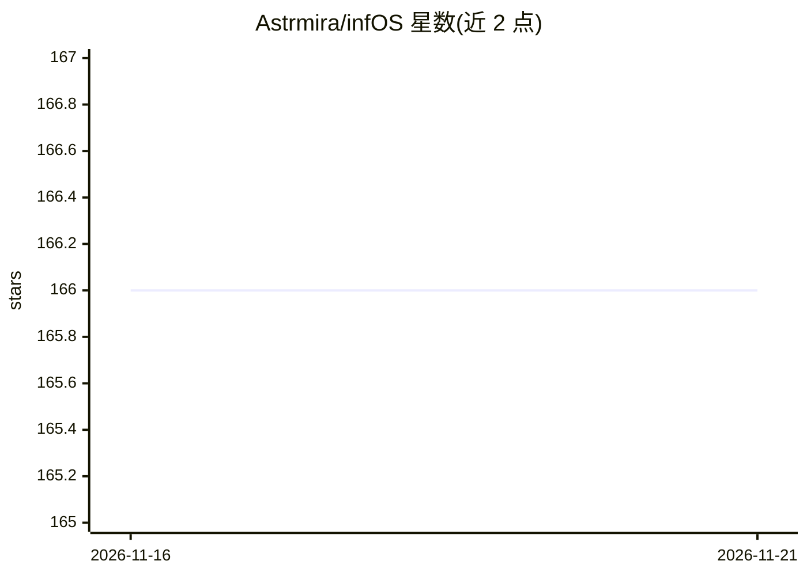

# Astrmira/infOS

⭐ 166 · TypeScript · Apache-2.0 · 推送 2026-11-18 · [GitHub](https://github.com/Astrmira/infOS) · [官网](https://wiki.perofamily.top/) · 组织维护 · 中文 README

**带长记忆引擎与桌面客户端的 AI 伙伴运行时**

以主 Agent 为中心的 AI 工作站与运行时内核，配套桌面应用 PeroperoChat 提供日常陪伴聊天。核心机制：基于 TriviumDB 的联想记忆（EventNote 事件记事、向量+图检索、Reflection 自整 理）、后端统一上下文编译器、NIT 工具协议、CapabilityGate 权限门控、Package(Manifest V2)扩展体系，并含 QQ/Discord 社交子应用与 Arca 写作、Pictoria 画布两个可独立运行子应用。技术栈 TypeScript(Hono+Vue3+Electron)，支持 Docker Compose 一键部署。

## 筛选速览

| 维度 | 判定 | 备注 |
|---|---|---|
| AI 角色 | `ai-native` | 本体是模型或模型工具 |
| 许可风险 | `permissive` | Apache-2.0 |
| 部署形态 | `desktop` | 安装包/桌面程序 |
| 模型依赖 | — | README 未给出锁定关系 |
| 硬件要求 | — | 无带数字的原话,不猜 |
| 安装摩擦 | `low` | 无编译、无系统依赖或容器化 |
| 成熟度 | — | 结构信号不足 |

## 能力要点

- EventNote 长记忆：候选→门控→正式记忆三层把关，带来源追溯
- 自动 RAG（向量+BM25，可选 SA-PPR/FISTA/DPP/Leiden 高级管线）与确定性 BFS 主动图查询
- Package(Manifest V2)统一扩展安装/签名/版本，兼容 MCP 协议
- Docker Compose 基于 GHCR 预构建镜像一键部署

## 适用场景

- 和有记忆、有人设的 AI 伙伴日常聊天与共同创作
- 在 QQ/Discord 群里让同一 AI 伙伴跨端互动且记忆互通
- 开发者通过 Skill/Tool 扩展为 AI 伙伴添加新能力
- 用 Arca/Pictoria 子应用进行写作与图像创作工作流

## 场景标签

`Agent 记忆` `AI 助手` `聊天机器人` · 领域:Agent 开发

## 证据(README 行号)

> L18:  infOS 是以主 Agent 为中心的 AI 工作站与运行时内核。 萌动链接：PeroperoChat！ 是它面向日常陪伴的桌面应用。
> L58: PeroperoChat 不仅仅是一个桌宠应用，它是 **Pero** 的"灵魂容器"；而 **infOS** 是承载它的智能运行时内核——一个以"主 Agent"为中心的 AI 工作站。它已从 Python 版全面重写为 **T

## 星数曲线

2026-11-16 166 → 2026-11-21 166（+0）

---
*卡片 v1 · prompt 1.4 · 生成 2026-11-17 · 置信度 mid · 依据 README sha `0b0c6be2f353` · [字段定义](../../DATASET.md)*
