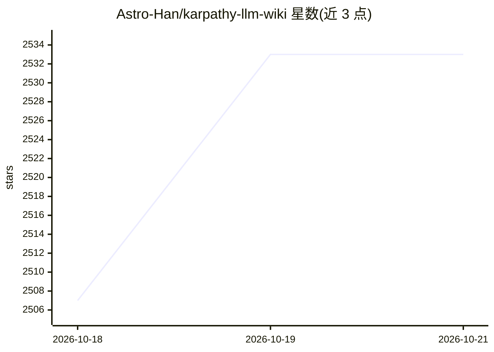

# Astro-Han/karpathy-llm-wiki

⭐ 2,574 · Python · MIT · 推送 2026-07-23 · [GitHub](https://github.com/Astro-Han/karpathy-llm-wiki) · 个人维护

**给编程 Agent 安装的可复用技能：构建带引用的 LLM 个人维基**

遵循 agentskills.io 开放标准的 Agent Skills 技能包，可安装到 Claude Code、Cursor、Codex CLI、OpenCode 等工具。它让编程 Agent 执行三种操作：Ingest（把 URL/文件/文本存入 raw/ 并编译为 wiki/ 下的 markdown 知识页）、Query（检索维基并给出带引用的回答）、Lint（检查链接、索引与交叉引用并自动修复）。明确不做向量/图搜索、行号引用、置信分数等（L119-131 列出设计边界）。基于 2026 年 4 月起日常维护的 94 篇文章生产知识库的实践。

## 筛选速览

| 维度 | 判定 | 备注 |
|---|---|---|
| AI 角色 | `ai-ecosystem` | LLM/agent 周边工具 |
| 许可风险 | `permissive` | MIT |
| 部署形态 | `library` | 以包/库形式分发 |
| 模型依赖 | — | README 未给出锁定关系 |
| 硬件要求 | — | 无带数字的原话,不猜 |
| 安装摩擦 | `low` | 无编译、无系统依赖或容器化 |
| 成熟度 | — | 结构信号不足 |

## 能力要点

- Ingest/Query/Lint 三操作：源摄入→维基编译→带引用问答→一致性检查
- 兼容 agentskills.io 标准，支持 Claude Code/Cursor/Codex CLI/OpenCode
- raw/ 不可变源材料 + wiki/ 由 LLM 维护的结构化知识页
- npx add-skill 一条命令安装

## 适用场景

- 让编程 Agent 替我维护可持续增长的个人/项目知识库
- 摄入论文、网页、PDF 后直接向维基提问并获得带引用的回答
- 定期 lint 检查维基的链接与索引健康

## 场景标签

`知识库管理` `文档问答` · 领域:知识与检索

## 证据(README 行号)

> L3: **A reusable skill for building Karpathy-style LLM wikis with Claude Code, Cursor, Codex, and other Agent Skills too
> L13: `karpathy-llm-wiki` packages Karpathy's LLM Wiki idea into one installable Agent Skills skill. Your coding agent in
> L93: This skill follows the agentskills.io open standard:

## 星数曲线

2026-10-18 2,507 → 2026-10-21 2,533（+26）

---
*卡片 v1 · prompt 1.4 · 生成 2026-10-21 · 置信度 high · 依据 README sha `6ae2ec48844f` · [字段定义](../../DATASET.md)*
