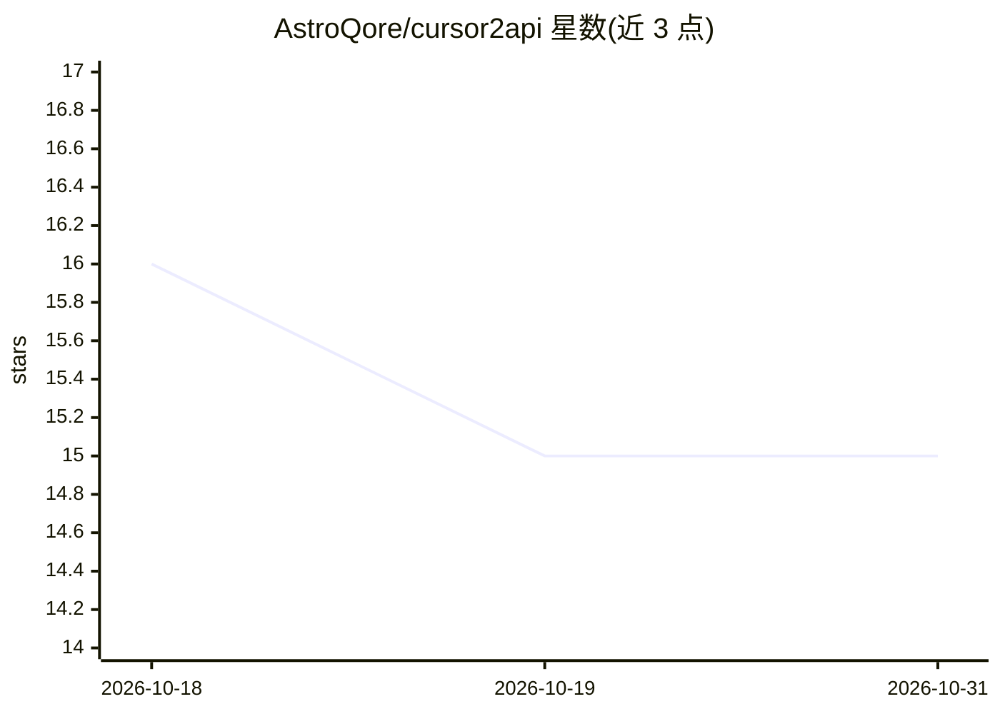

# AstroQore/cursor2api

⭐ 15 · TypeScript · AGPL-3.0 · 推送 2026-09-03 · [GitHub](https://github.com/AstroQore/cursor2api) · 组织维护 · 中文 README

**把 Cursor 订阅转换为 OpenAI 兼容 API 的协议网关**

自部署的代理服务：直接连接 Cursor 官方 agent.v1 后端（Connect-RPC over HTTP/2 + protobuf），将其转换为 /v1/chat/completions 的 OpenAI 兼容接口，供已订阅 Cursor 的用户以 API 形式使用自身配额。支持 SSE 流式、真实 tool_calls 与工具结果回放、200+ 账户可用模型实时读取、多账号轮询池与令牌自动刷新。通过登录流程获取令牌，系统提示词仅尽力支持（Cursor 服务端自行组装模型提示词），prompt_tokens 恒为 0。提供 Docker 与 Node 20+ 源码两种运行方式。

## 筛选速览

| 维度 | 判定 | 备注 |
|---|---|---|
| AI 角色 | `ai-ecosystem` | LLM/agent 周边工具 |
| 许可风险 | `viral` | AGPL-3.0 |
| 部署形态 | `self-host` | docker 或自建部署 |
| 模型依赖 | — | README 未给出锁定关系 |
| 硬件要求 | — | 无带数字的原话,不猜 |
| 安装摩擦 | `low` | 无编译、无系统依赖或容器化 |
| 成熟度 | — | 结构信号不足 |

## 能力要点

- 直连 agent.v1 协议，无 cursor-agent CLI 子进程与无头浏览器
- 真实 tool_calls、多轮 agent 循环与工具结果回放
- 多账号轮询池与访问令牌自动刷新（约两个月有效期）
- 上游 Connect 错误码映射为 OpenAI 风格状态码（如 429）

## 适用场景

- 用 Cline/Roo/Continue/LobeChat 等 OpenAI 兼容客户端调用 Cursor 订阅配额
- 将多个 Cursor 订阅账号聚合为统一 API 供脚本使用
- 在自有聚合层（如 CLIProxyAPI）后面挂载 Cursor 通道

## 场景标签

`模型网关` · 领域:Agent 开发

## 证据(README 行号)

> L3: **Use your Cursor subscription as an OpenAI-compatible API.**
> L17: HTTP/2 with protobuf — and exposes it as `/v1/chat/completions`. No `cursor-agent`
> L21: your app ──► /v1/chat/completions ──► cursor2api ──► api2.cursor.sh

## 星数曲线

2026-10-18 16 → 2026-10-31 15（-1）

---
*卡片 v1 · prompt 1.4 · 生成 2026-10-31 · 置信度 mid · 依据 README sha `8bba62f5156b` · [字段定义](../../DATASET.md)*
