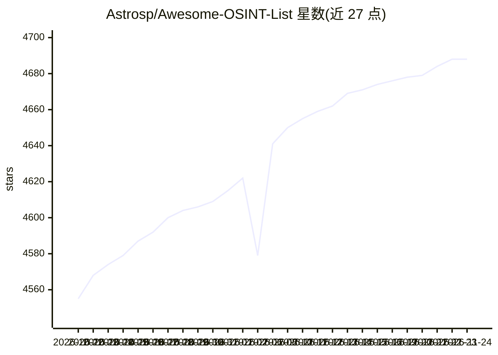

# Astrosp/Awesome-OSINT-List

⭐ 4,688 · Shell · GPL-3.0 · 推送 2026-11-17 · [GitHub](https://github.com/Astrosp/Awesome-OSINT-List) · [官网](https://astrosp.github.io/osint-web/) · 个人维护

**面向安全研究者的 OSINT 工具与资源清单**

单文件组织的 OSINT（开源情报）工具与资源精选清单，收录条目覆盖数据泄露与威胁情报、侦察与网络扫描、人物与身份解析、社交媒体、地理定位、企业与加密货币、公共记录、暗网、漏洞赏金等 13 个类别。每个条目附一句功能说明与外链。含 AI 章节，列举 AI 助手、AI 搜索引擎、学术研究工具、AI 内容检测、LLM 安全测试与对抗工具等。清单本身不提供软件安装或运行方式，仅作链接索引；页面含赞助商 WebVetted 的推广内容。

## 筛选速览

| 维度 | 判定 | 备注 |
|---|---|---|
| AI 角色 | `ai-knowledge` | 知识聚合/清单类 |
| 许可风险 | `viral` | GPL-3.0 |
| 部署形态 | `None` |  |
| 模型依赖 | — | README 未给出锁定关系 |
| 硬件要求 | — | 无带数字的原话,不猜 |
| 安装摩擦 | `medium` | 含编译或系统依赖之一 |
| 成熟度 | — | 结构信号不足 |

## 能力要点

- 13 个类别组织 OSINT 工具与资源条目
- 含 LLM 安全章节：漏洞扫描、提示注入测试、对抗样本库、隐私审计工具
- 覆盖泄露数据库搜索、用户名枚举、AI 内容检测等具体用途的工具链接
- 单文件维护，条目附一句功能描述

## 适用场景

- 渗透测试或漏洞赏金前收集目标信息
- 排查自己的邮箱是否出现在已知数据泄露库
- 查找用于 LLM 安全测试与红队演练的工具
- 做身份调查时按类别查找可用工具

## 场景标签

`精选清单` `网络安全` · 领域:学习与行业

## 证据(README 行号)

> L3: A curated list of OSINT tools and resources for penetration testing, reverse searching, red team operations, informa
> L99: ## AI

## 星数曲线

2026-10-22 4,555 → 2026-11-24 4,688（+133）

---
*卡片 v1 · prompt 1.4 · 生成 2026-11-22 · 置信度 high · 依据 README sha `94da7219ed67` · [字段定义](../../DATASET.md)*
