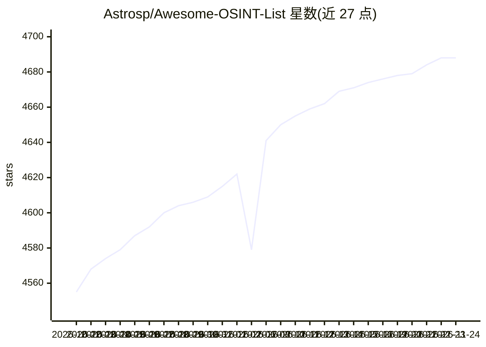

# Astrosp/Awesome-OSINT-List

⭐ 4,694 · Shell · GPL-3.0 · 推送 2026-11-23 · [GitHub](https://github.com/Astrosp/Awesome-OSINT-List) · [官网](https://astrosp.github.io/osint-web/) · 个人维护

**面向安全研究者的 OSINT 工具与资源分类清单**

单文件维护的 OSINT 工具精选清单，覆盖渗透测试、反向搜索、红队行动、信息收集、漏洞赏金与网络情报等方向。内容按 13 个章节组织：数据泄露查询、侦察扫描、人物身份解析、社交媒体、地理定位、企业金融加密货币、公共记录、暗网、漏洞赏金、AI 工具等，每条以链接加简介形式列出，其中 AI 章节细分为助手/搜索引擎/研究工具/威胁情报/LLM 安全等子类。清单含赞助商板块，未包含各工具的安装说明或部署方式。

## 筛选速览

| 维度 | 判定 | 备注 |
|---|---|---|
| AI 角色 | `ai-knowledge` | 知识聚合/清单类 |
| 许可风险 | `viral` | GPL-3.0 |
| 部署形态 | `None` |  |
| 模型依赖 | — | README 未给出锁定关系 |
| 硬件要求 | — | 无带数字的原话,不猜 |
| 安装摩擦 | `medium` | 含编译或系统依赖之一 |
| 成熟度 | — | 结构信号不足 |

## 能力要点

- 13 个分类章节覆盖 OSINT 全流程工具
- 含 LLM 安全专项：漏洞扫描、提示注入、对抗测试等工具收录
- 覆盖泄露数据库、身份解析、地理定位等 13 类资源
- AI 章节含 AI 检测/验证与模型安全分析子类

## 适用场景

- 渗透测试前收集目标域名、邮箱、凭据泄露信息
- 漏洞赏金项目的信息收集与侦察阶段查找工具
- 查找 LLM 安全测试与对抗样本工具
- 调查社交媒体账号、图片与地理位置信息

## 场景标签

`精选清单` `网络安全` · 领域:学习与行业

## 证据(README 行号)

> L3: A curated list of OSINT tools and resources for penetration testing, reverse searching, red team operations, informa
> L100: ## AI

## 星数曲线

2026-10-22 4,555 → 2026-11-24 4,688（+133）

---
*卡片 v1 · prompt 1.4 · 生成 2026-11-24 · 置信度 high · 依据 README sha `9c4e4b74fa54` · [字段定义](../../DATASET.md)*
