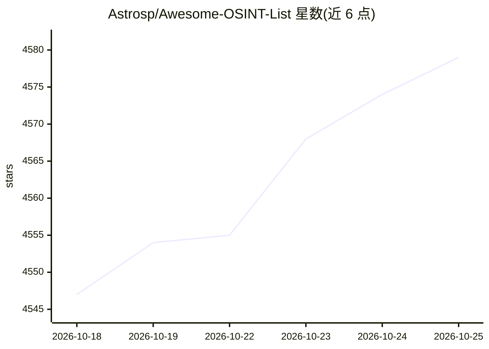

# Astrosp/Awesome-OSINT-List

⭐ 4,587 · Shell · GPL-3.0 · 推送 2026-10-22 · [GitHub](https://github.com/Astrosp/Awesome-OSINT-List) · [官网](https://astrosp.github.io/osint-web/) · 个人维护

**面向安全与情报人员的 OSINT 工具与网站清单**

单文件维护的 OSINT 资源清单：按 90 余个类别（泄露数据、基础 OSINT、侦察、AI 助手、AI 搜索、LLM 安全、地理、社交媒体、威胁情报、政府记录等）收录工具与网站条目，每条含名称与一句功能描述。覆盖渗透测试、红队行动、反向搜索、信息收集、bug bounty 场景，其中 AI 板块收录聊天平台、AI 搜索、AI 检测与 LLM 漏洞测试工具。清单本身不含安装程序，仅为链接与描述的策展。给网络安全专业人员、研究者与 bug bounty 猎人查阅使用。页面顶部含 WebVetted OSINT 的赞助推广区块。

## 筛选速览

| 维度 | 判定 | 备注 |
|---|---|---|
| AI 角色 | `ai-knowledge` | 知识聚合/清单类 |
| 许可风险 | `viral` | GPL-3.0 |
| 部署形态 | `None` |  |
| 模型依赖 | — | README 未给出锁定关系 |
| 硬件要求 | — | 无带数字的原话,不猜 |
| 安装摩擦 | `medium` | 含编译或系统依赖之一 |
| 成熟度 | — | 结构信号不足 |

## 能力要点

- 90+ 类别组织的 OSINT 工具/网站条目，覆盖泄露、侦察、地理、威胁情报等
- AI 板块收录 AI 助手、AI 搜索、AI 检测与验证类工具
- LLM 安全板块收录 Garak、PyRIT、LLM Guard 等漏洞测试与防护工具
- 每条目附一句功能描述，单文件可读

## 适用场景

- 渗透测试或红队行动前查找信息收集工具
- 按社交媒体平台或数据类型（邮箱/电话/用户名）定位 OSINT 查询站点
- 查找 LLM 安全测试与 AI 内容检测工具
- 了解 OSINT 工具生态的覆盖范围

## 场景标签

`精选清单` `网络安全` · 领域:学习与行业

## 证据(README 行号)

> L5: A list of osint tools/websites for pentration testing, Reverse Searching, Red team Oprations, information gathering,
> L14: ## Index

## 星数曲线

2026-10-18 4,547 → 2026-10-25 4,579（+32）

---
*卡片 v1 · prompt 1.4 · 生成 2026-10-20 · 置信度 high · 依据 README sha `865c01fabcb7` · [字段定义](../../DATASET.md)*
