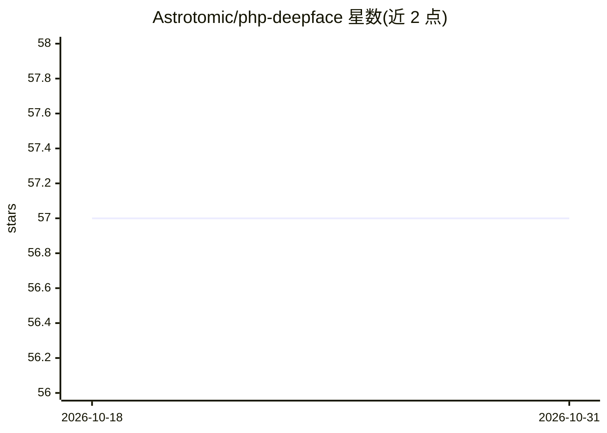

# Astrotomic/php-deepface

⭐ 57 · PHP · MIT · 推送 2026-08-15 · [GitHub](https://github.com/Astrotomic/php-deepface) · [官网](https://github.com/serengil/deepface) · 个人维护

**PHP 的人脸识别与面部属性分析适配库（封装 Python deepface）**

面向 PHP 开发者的适配层：通过调用本地 Python 的 deepface 框架，把人脸识别能力引入 PHP 应用。自动检测本地 Python 可执行文件（也可手动指定路径），提供构建模型（如 VGG-Face）、人脸检测与对齐、两张图的人脸验证、在图像库中查找身份、生成面部向量嵌入，以及年龄/性别/情绪/种族属性分析。前置要求先用 pip 安装 deepface，再通过 Composer 安装本包。MIT 许可，含 Treeware 植树请求。

## 筛选速览

| 维度 | 判定 | 备注 |
|---|---|---|
| AI 角色 | `ai-native` | 本体是模型或模型工具 |
| 许可风险 | `permissive` | MIT |
| 部署形态 | `library` | 以包/库形式分发 |
| 模型依赖 | — | README 未给出锁定关系 |
| 硬件要求 | — | 无带数字的原话,不猜 |
| 安装摩擦 | `low` | 无编译、无系统依赖或容器化 |
| 成熟度 | — | 结构信号不足 |

## 能力要点

- 封装 Python deepface，供 PHP 应用调用
- 支持人脸检测、验证、识别（find）与向量嵌入
- 支持年龄、性别、情绪、种族的面部属性分析
- 自动检测本地 Python 可执行文件，可指定路径

## 适用场景

- 在 PHP/Laravel 项目中实现两张照片的同一人验证
- 在图像库中查找目标人脸的身份
- 对上传照片做年龄、性别、情绪等属性分析

## 场景标签

`人脸识别` · 领域:感知与多模态

## 证据(README 行号)

> L3: Latest Version
> L51: PHP DeepFace provides a wide range of functionalities for face recognition and facial attribute analysis. Here are 

## 星数曲线

2026-10-18 57 → 2026-10-31 57（+0）

---
*卡片 v1 · prompt 1.4 · 生成 2026-10-24 · 置信度 mid · 依据 README sha `918da2d586c6` · [字段定义](../../DATASET.md)*
