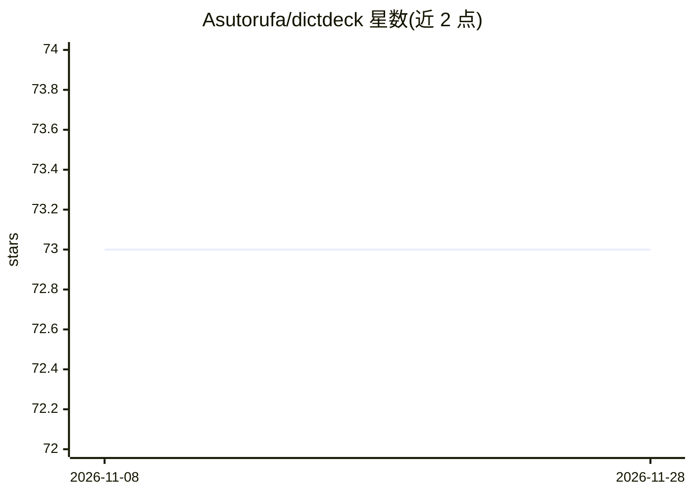

# Asutorufa/dictdeck

⭐ 73 · Rust · 推送 2026-11-27 · [GitHub](https://github.com/Asutorufa/dictdeck) · 个人维护 · 中文 README

**自托管 AI 词典：LLM 释义、翻译与生词复习卡**

自托管的词典、翻译与词汇卡片应用，内置多部词典（Weblio、コトバンク、沪江、Google Translate）查询，并可接入流式 LLM 生成释义与翻译。提供 Web 应用、划词翻译浏览器扩展（Chrome/Firefox/Safari）、Rust 编写的 CLI 查词工具、Telegram bot、MCP 词典服务器。部署目标为 Cloudflare Workers（含 D1 数据库与定时任务），也可本地 npm 运行开发环境。支持生词本与拖拽复习卡片。

## 筛选速览

| 维度 | 判定 | 备注 |
|---|---|---|
| AI 角色 | `ai-native` | 本体是模型或模型工具 |
| 许可风险 | `none` | — |
| 部署形态 | `library` | 以包/库形式分发 |
| 模型依赖 | — | README 未给出锁定关系 |
| 硬件要求 | — | 无带数字的原话,不猜 |
| 安装摩擦 | `medium` | 含编译或系统依赖之一 |
| 成熟度 | — | 结构信号不足 |

## 能力要点

- 内置 Weblio/コトバンク/沪江/Google Translate 多词典查询
- 流式 LLM 释义，可管理多个 LLM provider
- 跨浏览器划词翻译扩展（Chrome/Firefox/Safari）
- Streamable HTTP MCP 词典服务器，支持 token 权限控制

## 适用场景

- 查日语/英语/韩语词汇并保存生词本
- 网页划词即时翻译并流式查看解释
- 通过复习卡片做词汇记忆回顾
- 为 MCP 客户端提供词典查询工具

## 场景标签

`知识库管理` · 领域:知识与检索

## 证据(README 行号)

> L5: DictDeck is a self-hosted AI dictionary, translator, and vocabulary flashcard app.
> L6: It brings together built-in dictionaries, streaming LLM explanations (OpenAI, Gemini, Vertex AI, Anthropic, Workers 
> L15: - **Dictionary Desk**: Look up words and sentences across built-in dictionaries (Weblio, コトバンク, Hujiang, Google Tra

## 星数曲线

2026-11-08 73 → 2026-11-28 73（+0）

---
*卡片 v1 · prompt 1.4 · 生成 2026-11-28 · 置信度 high · 依据 README sha `1a03e503e99e` · [字段定义](../../DATASET.md)*
