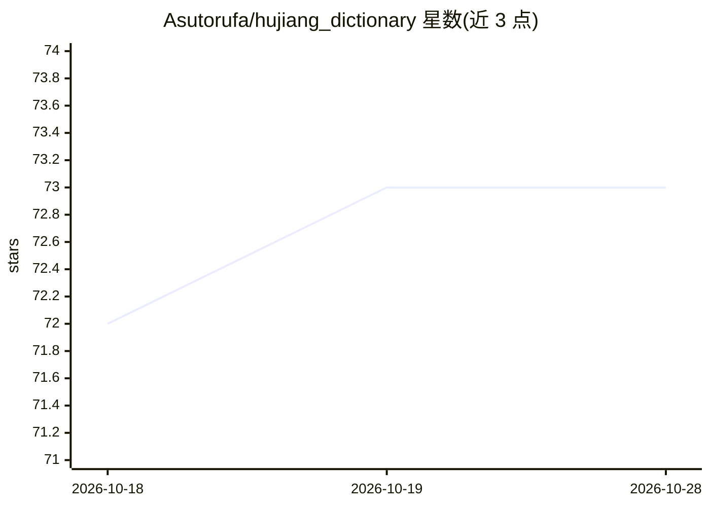

# Asutorufa/hujiang_dictionary

⭐ 73 · Rust · 推送 2026-10-28 · [GitHub](https://github.com/Asutorufa/hujiang_dictionary) · 个人维护 · 中文 README

**自托管 AI 词典/翻译/生词卡应用，支持 Telegram bot 与浏览器扩展**

DictDeck 是用 Rust 编写的自托管 AI 词典、翻译与生词本应用：聚合多个词典源（jc/cj/en、weblio、コトバンク、Google 翻译），提供 LLM 解释与搜索 RAG、生词保存与复习卡片。可部署到 Cloudflare Workers 运行 Telegram bot、HTTP API 与定时任务；附带可翻译网页选中文字的浏览器扩展（Chrome/Firefox/Safari），并通过 Worker 暴露 Streamable HTTP MCP 端点提供词典读写工具。本地运行需 cargo 构建二进制，扩展需 npm 构建。

## 筛选速览

| 维度 | 判定 | 备注 |
|---|---|---|
| AI 角色 | `ai-native` | 本体是模型或模型工具 |
| 许可风险 | `none` | — |
| 部署形态 | `library` | 以包/库形式分发 |
| 模型依赖 | — | README 未给出锁定关系 |
| 硬件要求 | — | 无带数字的原话,不猜 |
| 安装摩擦 | `medium` | 含编译或系统依赖之一 |
| 成熟度 | — | 结构信号不足 |

## 能力要点

- 聚合多词典源查询与 Google 翻译的 CLI（jc/cj/en/weblio/ktbk/google）
- LLM 解释与搜索 RAG、生词保存与复习卡片
- Telegram bot、HTTP API、定时任务部署于 Cloudflare Workers
- Streamable HTTP MCP 端点提供 dictionary.search/get 与批量修改工具

## 适用场景

- 查日语/英语/中文单词并保存生词复习
- 通过 Telegram bot 随时查词与翻译
- 在任意网页划词翻译（浏览器扩展）
- 把词典能力以 MCP 工具接入 AI 客户端

## 场景标签

`RAG` · 领域:知识与检索

## 证据(README 行号)

> L5: DictDeck is a self-hosted AI dictionary, translator, and vocabulary flashcard app.
> L6: It supports multiple dictionary sources, LLM-powered explanations, saved words,

## 星数曲线

2026-10-18 72 → 2026-10-28 73（+1）

---
*卡片 v1 · prompt 1.4 · 生成 2026-10-24 · 置信度 high · 依据 README sha `d4ff12fbe2a9` · [字段定义](../../DATASET.md)*
