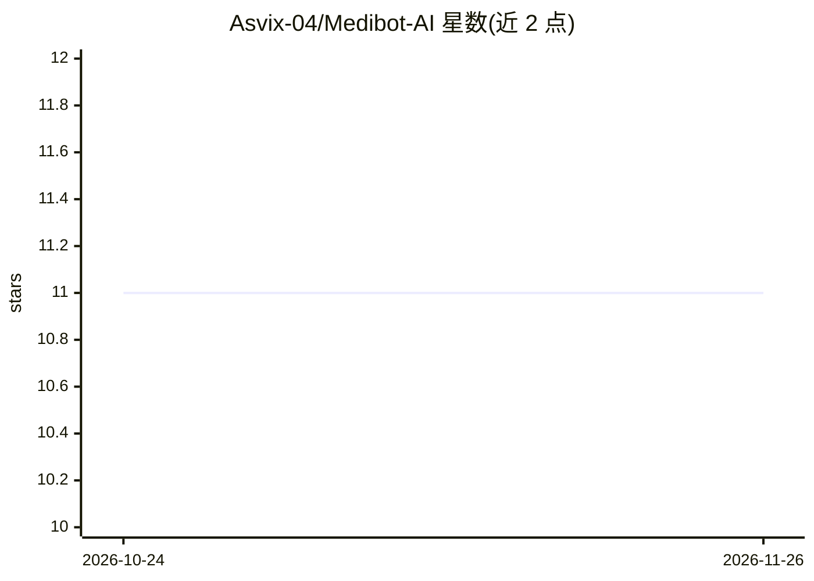

# Asvix-04/Medibot-AI

⭐ 11 · JavaScript · Unlicense · 推送 2025-12-10 · [GitHub](https://github.com/Asvix-04/Medibot-AI) · [官网](https://www.medibot-ai.com) · 组织维护

**面向用户的 AI 医疗聊天机器人：问答、健康追踪与医院查找**

ASVIX 出品的 AI 医疗聊天机器人，通过对话界面帮助用户验证医学问题、追踪健康指标并联系附近医疗服务。机制上结合 Ollama 与 RAG 生成医学回答，集成 OpenAI Whisper 做语音转文字，用 Google Maps API 定位附近医院/诊所/药房，支持预约管理、健康仪表盘（血压/心率/脉搏/胆固醇）与个性化健康报告生成。前后端分离部署，需要自建 MongoDB 与 Firebase 配置。

## 筛选速览

| 维度 | 判定 | 备注 |
|---|---|---|
| AI 角色 | `ai-native` | 本体是模型或模型工具 |
| 许可风险 | `permissive` | Unlicense |
| 部署形态 | `None` |  |
| 模型依赖 | local-ok | 支持本地模型 |
| 硬件要求 | — | 无带数字的原话,不猜 |
| 安装摩擦 | `low` | 无编译、无系统依赖或容器化 |
| 成熟度 | — | 结构信号不足 |

## 能力要点

- Ollama + RAG 组合的医学问答聊天机器人
- OpenAI Whisper 语音转文字的语音交互
- Google Maps API 定位附近医院、诊所、药房
- 健康指标仪表盘与个性化健康报告生成

## 适用场景

- 通过对话验证自己的医学疑问
- 记录并追踪血压、心率等健康指标
- 在地图上查找附近的医院、诊所与药房并预约

## 场景标签

`聊天机器人` `RAG` `语音识别` · 领域:对话与助手

## 证据(README 行号)

> L17: Is an advanced AI-powered medical chatbot designed to assist users in validating their medical queries, tracking he
> L21: - AI Medical Chatbot: Built using a combination of the Ollama and RAG models to provide real-time, accurate respons

## 星数曲线

2026-10-24 11 → 2026-11-26 11（+0）

---
*卡片 v1 · prompt 1.4 · 生成 2026-11-19 · 置信度 high · 依据 README sha `b9039830f6bd` · [字段定义](../../DATASET.md)*
