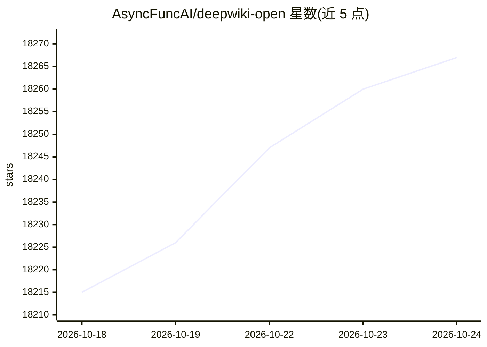

# AsyncFuncAI/deepwiki-open

⭐ 18,267 · Python · MIT · 推送 2026-10-23 · [GitHub](https://github.com/AsyncFuncAI/deepwiki-open) · [官网](https://grok-wiki.com/) · 组织维护 · 中文 README

**为 GitHub/GitLab/Bitbucket 仓库自动生成 AI Wiki 的工具**

输入仓库名即可为 GitHub、GitLab 或 Bitbucket 仓库自动生成可交互的 Wiki：分析代码结构、生成文档、创建可视化图解、组织为可导航的 Wiki，并生成面向代码导览的 codemap。项目自称是对 DeepWiki 的自有实现，2.0 版本以 Grok-Wiki 名称发布，提供 grok-wiki.com 下载入口。README 采用多语言（含简繁中文等 9 种语言），以 MIT 许可证发布，接受社区 issue 与 PR 贡献。

## 筛选速览

| 维度 | 判定 | 备注 |
|---|---|---|
| AI 角色 | `ai-enhanced` | 去掉 AI 部分产品仍成立 |
| 许可风险 | `permissive` | MIT |
| 部署形态 | `None` |  |
| 模型依赖 | — | README 未给出锁定关系 |
| 硬件要求 | — | 无带数字的原话,不猜 |
| 安装摩擦 | `low` | 无编译、无系统依赖或容器化 |
| 成熟度 | — | 结构信号不足 |

## 动量与使用信号

- 维护:`active` — 距上次 push 44.5 天,年发版 0,65 位贡献者
- 涨星:近 1 天 **+9**(自 20261016 起算)
- 安装:github 包 `release-assets` 月下载无数据

## 能力要点

- 输入仓库名即可生成分析文档、可视化图解与 codemap
- 支持 GitHub、GitLab、Bitbucket 三类仓库托管平台
- 2.0 版本以 Grok-Wiki 名称发布，提供站点下载入口

## 适用场景

- 为不熟悉的开源仓库快速生成交互式文档 Wiki
- 用 codemap 做以代码为中心的导览式阅读

## 场景标签

`文档问答` · 领域:知识与检索

## 证据(README 行号)

> L5: **DeepWiki** is my own implementation attempt of DeepWiki, automatically creates beautiful, interactive wikis for an
> L20: ## Deepwiki-Open 2.0 (Grok Wiki is now live)

## 星数曲线

2026-10-18 18,215 → 2026-10-24 18,267（+52）

---
*卡片 v1 · prompt 1.4 · 生成 2026-10-18 · 置信度 mid · 依据 README sha `e7076e4c0070` · [字段定义](../../DATASET.md)*
