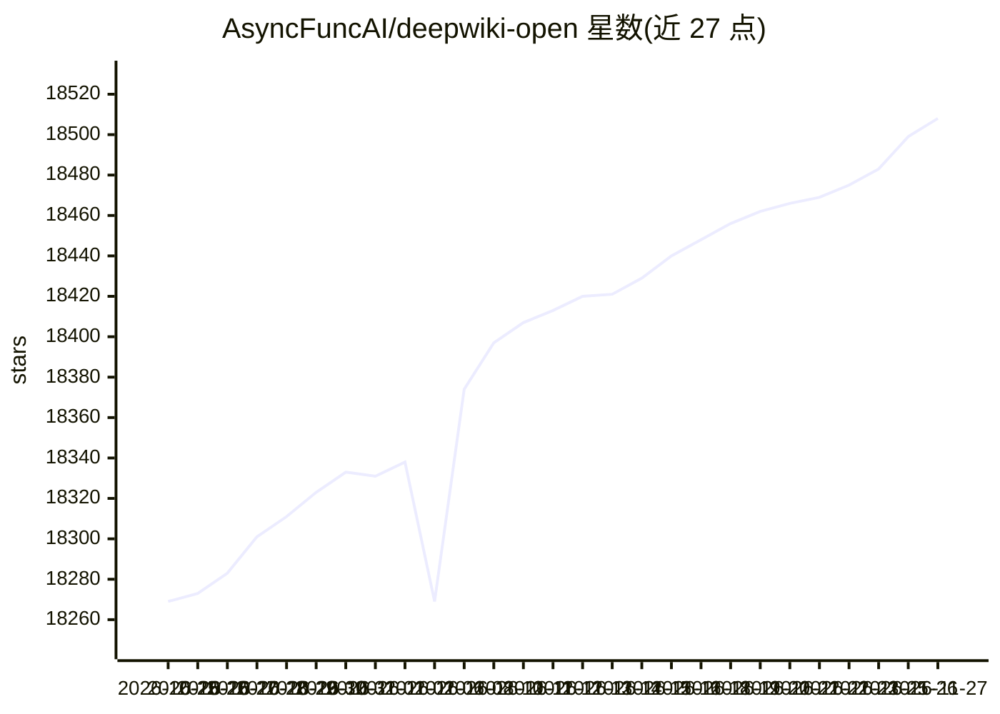

# AsyncFuncAI/deepwiki-open

⭐ 18,508 · Python · MIT · 推送 2026-11-26 · [GitHub](https://github.com/AsyncFuncAI/deepwiki-open) · [官网](https://grok-wiki.com/) · 组织维护 · 中文 README

**为 GitHub/GitLab/Bitbucket 仓库自动生成 AI Wiki**

DeepWiki-Open（Grok-Wiki）是针对代码仓库的自动 Wiki 生成器：输入仓库名后，分析代码结构、生成文档、绘制解释性图表、组织为可导航的 Wiki，并生成面向代码导览的 codemap。可自托管部署，2.0 版本提供 grok-wiki.com 下载入口，另附 Kubernetes Helm Chart（使用 ghcr 镜像、从 Secret 读取 Provider 密钥、PVC 持久化）。采用 MIT 许可，README 提供多语言文档入口。

## 筛选速览

| 维度 | 判定 | 备注 |
|---|---|---|
| AI 角色 | `ai-native` | 本体是模型或模型工具 |
| 许可风险 | `permissive` | MIT |
| 部署形态 | `library` | 以包/库形式分发 |
| 模型依赖 | — | README 未给出锁定关系 |
| 硬件要求 | — | 无带数字的原话,不猜 |
| 安装摩擦 | `low` | 无编译、无系统依赖或容器化 |
| 成熟度 | — | 结构信号不足 |

## 动量与使用信号

- 维护:`active` — 距上次 push 44.5 天,年发版 0,65 位贡献者
- 涨星:近 1 天 **+9**(自 20261016 起算)
- 安装:github 包 `release-assets` 月下载无数据

## 能力要点

- 分析仓库代码结构并生成文档与可视化图表
- 生成代码中心导览的 codemap
- 提供 Kubernetes Helm Chart 部署方案
- 支持 GitHub/GitLab/Bitbucket 仓库

## 适用场景

- 接手陌生开源仓库时快速生成交互式 Wiki
- 为团队内部 GitLab/Bitbucket 仓库自动产出文档
- 用 codemap 做代码结构的引导式讲解

## 场景标签

`文档问答` `AI 写作` · 领域:内容生成

## 证据(README 行号)

> L5: **DeepWiki** is my own implementation attempt of DeepWiki, automatically creates beautiful, interactive wikis for an
> L7: 1. Analyze the code structure
> L28: A Helm chart lives in `charts/deepwiki-open`. It runs the published `ghcr.io/asyncfuncai/deepwiki-open` image, read

## 星数曲线

2026-10-25 18,269 → 2026-11-27 18,508（+239）

---
*卡片 v1 · prompt 1.4 · 生成 2026-11-22 · 置信度 mid · 依据 README sha `efef358e0b0c` · [字段定义](../../DATASET.md)*
