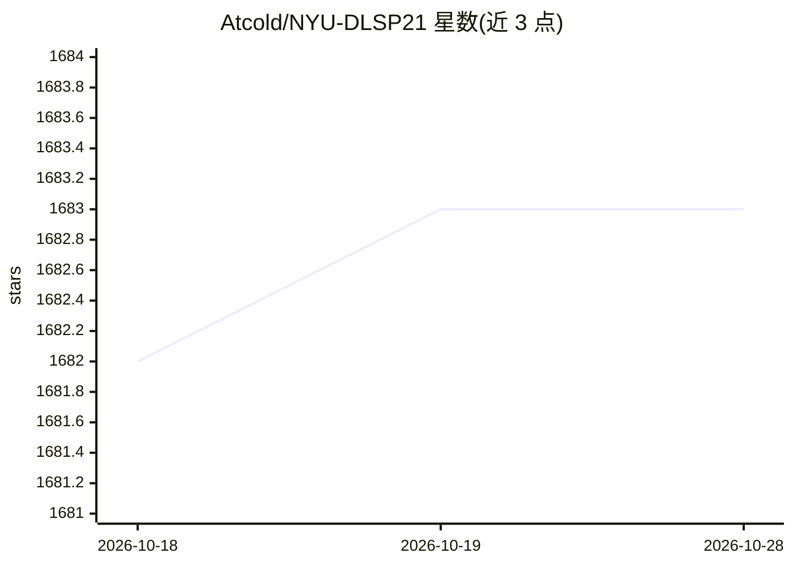

# Atcold/NYU-DLSP21

⭐ 1,683 · Jupyter Notebook · 推送 2025-11-11 · [GitHub](https://github.com/Atcold/NYU-DLSP21) · [官网](https://atcold.github.io/NYU-DLSP21/) · 组织维护

**NYU 2021 春季深度学习课程的教学材料仓库**

纽约大学 2021 年春季深度学习课程（Yann LeCun 与 Alfredo Canziano 授课）的教学材料仓库，发布课程幻灯片、notebook 与新的转录文本。课程前半段覆盖三大主题：历史与反向传播/梯度下降、参数共享（循环与卷积网络）、潜变量能量模型（LV-EBM），每个主题配一次作业，每节课配一次实习课；后半段课程材料基于学生已掌握 LV-EBM 的前提重新设计。仓库还列出往届课程版本链接，更多信息指向课程网站。

## 筛选速览

| 维度 | 判定 | 备注 |
|---|---|---|
| AI 角色 | `ai-knowledge` | 知识聚合/清单类 |
| 许可风险 | `none` | — |
| 部署形态 | `None` |  |
| 模型依赖 | — | README 未给出锁定关系 |
| 硬件要求 | — | 无带数字的原话,不猜 |
| 安装摩擦 | `low` | 无编译、无系统依赖或容器化 |
| 成熟度 | — | 结构信号不足 |

## 能力要点

- 课程幻灯片、notebook 与转录文本的发布空间
- 围绕 LV-EBM 作为基础模块重新设计的课程结构
- 列出 2016-2020 年往届课程仓库版本

## 适用场景

- 跟随课程自学深度学习（含 EBM 主题）
- 查找课程配套的幻灯片与 notebook 材料
- 追溯往届 NYU 深度学习课程内容

## 场景标签

`教程课程` · 领域:学习与行业

## 证据(README 行号)

> L1: # NYU Deep Learning Spring 2021 (NYU-DLSP21)
> L31: That's why this repo has been created.
> L32: I'm **not** going to try to do the same insane work I've put up with last year, but I need a space where to post up

## 星数曲线

2026-10-18 1,682 → 2026-10-28 1,683（+1）

---
*卡片 v1 · prompt 1.4 · 生成 2026-10-21 · 置信度 high · 依据 README sha `297441eb99ed` · [字段定义](../../DATASET.md)*
