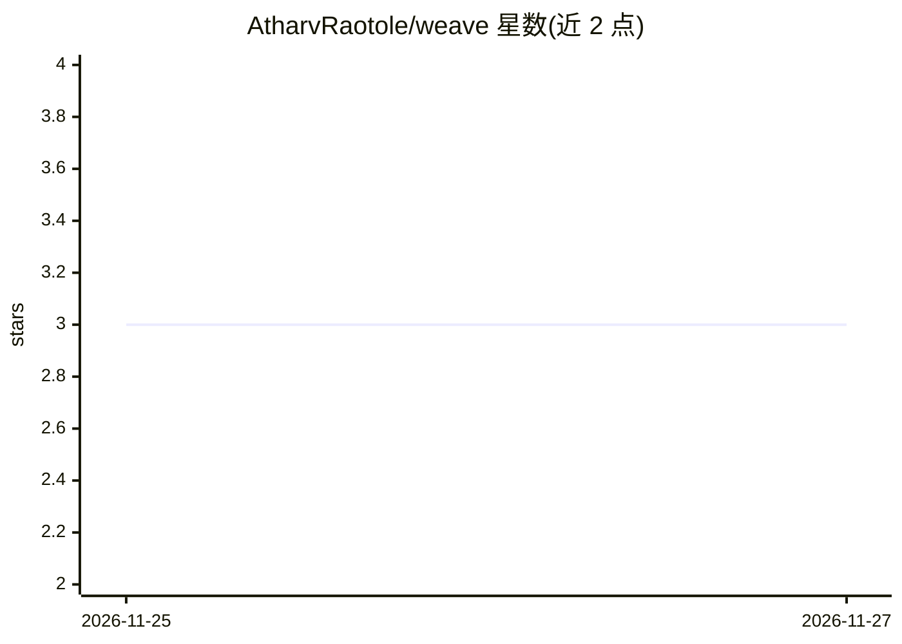

# AtharvRaotole/weave

⭐ 3 · Python · MIT · 推送 2026-11-25 · [GitHub](https://github.com/AtharvRaotole/weave) · [官网](https://pypi.org/project/weave-lang/) · 个人维护

**让 LLM agent 写脚本批量执行工具调用的 Rust 运行时**

Weave 提供一个受限 Python 子集解释器：模型不再逐轮发起工具调用，而是写一段含循环/推导式的脚本，Rust 运行时将其中独立的读取并行执行、按声明效果排序写入、只返回脚本输出。以 pip 包形式提供，提供 OpenAI Chat Completions/Responses、OpenAI Agents SDK、LangChain/LangGraph 的工具适配器，并可通过 MCP 接入 Claude Desktop/Cursor/VS Code 等客户端。README 附预注册基准结果，同时列出在部分 BFCL 任务与 tau-bench 上无收益或落后的场景。

## 筛选速览

| 维度 | 判定 | 备注 |
|---|---|---|
| AI 角色 | `ai-ecosystem` | LLM/agent 周边工具 |
| 许可风险 | `permissive` | MIT |
| 部署形态 | `library` | 以包/库形式分发 |
| 模型依赖 | — | README 未给出锁定关系 |
| 硬件要求 | — | 无带数字的原话,不猜 |
| 安装摩擦 | `low` | 无编译、无系统依赖或容器化 |
| 成熟度 | — | 结构信号不足 |

## 能力要点

- 模型写一段脚本替代多轮工具调用，Rust 运行时并行执行独立调用
- 提供 OpenAI / Agents SDK / LangChain 的工具适配器与 MCP 服务器
- 含预注册基准对比，并列出无效与负收益场景（BFCL、tau-bench）
- 示例脚本可离线运行，无需 API key

## 适用场景

- 对多个条目做同类查询的 fan-out 场景以减少模型往返
- 将工具结果过滤后再交给模型以节省上下文
- 为 Claude Desktop/Cursor 等客户端提供 MCP 工具服务器

## 场景标签

`Agent 框架` · 领域:Agent 开发

## 证据(README 行号)

> L15: helpers). A Rust runtime runs the script's independent reads together, orders writes by their declared effects, and
> L90: |OpenAI Chat Completions / Responses|`tool.chat_tool()`, `tool.responses_tool()`|
> L93: |Claude Desktop, Cursor, VS Code, Claude Code|`weave mcp-config --client claude --config tools.json --write` (or `c

## 星数曲线

2026-11-25 3 → 2026-11-27 3（+0）

---
*卡片 v1 · prompt 1.4 · 生成 2026-11-24 · 置信度 high · 依据 README sha `6c642f3d30d9` · [字段定义](../../DATASET.md)*
