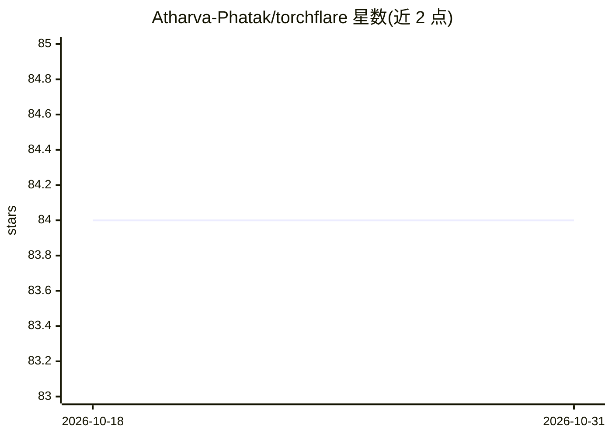

# Atharva-Phatak/torchflare

⭐ 84 · Python · Apache-2.0 · 推送 2026-10-26 · [GitHub](https://github.com/Atharva-Phatak/torchflare) · [官网](https://torchflare.readthedocs.io/en/latest/) · 个人维护

**简化 PyTorch 模型训练的高层框架：Keras 式训练体验**

面向 PyTorch 用户的模型训练封装框架：核心 Experiment 类处理训练循环样板代码、回调（模型检查点、早停等）与指标计算（后端使用 torchmetrics），提供接近 Keras 的使用体验；也允许编写自定义训练/验证循环。内置图像分类、图像分割、文本分类等标准任务的 Dataset/DataLoader，附带推理方法与训练历史记录导出。当前支持 CPU 与 GPU 训练，DDP 与 TPU 尚未支持。以 pip 包形式分发，附文档与 MNIST/BERT/DCGAN/BYOL 等示例。

## 筛选速览

| 维度 | 判定 | 备注 |
|---|---|---|
| AI 角色 | `ai-ecosystem` | LLM/agent 周边工具 |
| 许可风险 | `permissive` | Apache-2.0 |
| 部署形态 | `library` | 以包/库形式分发 |
| 模型依赖 | — | README 未给出锁定关系 |
| 硬件要求 | — | 无带数字的原话,不猜 |
| 安装摩擦 | `medium` | 含编译或系统依赖之一 |
| 成熟度 | — | 结构信号不足 |

## 能力要点

- Experiment 类封装训练循环、回调与指标计算
- 标准任务（图像分类/分割、文本分类）的现成 Dataset/DataLoader
- 回调支持模型检查点、早停等
- 当前支持 CPU/GPU 训练，DDP 与 TPU 暂不支持

## 适用场景

- 用少量代码完成 PyTorch 模型训练与实验
- 为图像或文本分类任务快速搭建训练流程
- 配合回调做检查点保存与早停，减少样板代码

## 场景标签

`模型训练` · 领域:训练与推理

## 证据(README 行号)

> L19: ***TorchFlare*** is a simple, beginner-friendly and an easy-to-use PyTorch Framework to train your models with ease
> L45: The core idea around TorchFlare is the Experiment

## 星数曲线

2026-10-18 84 → 2026-10-31 84（+0）

---
*卡片 v1 · prompt 1.4 · 生成 2026-10-24 · 置信度 high · 依据 README sha `3faad808a6db` · [字段定义](../../DATASET.md)*
