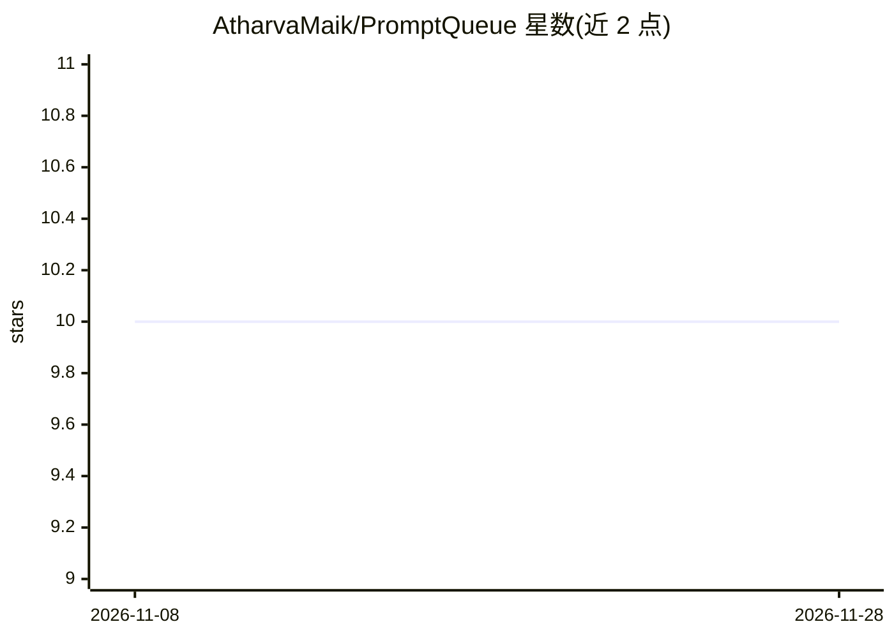

# AtharvaMaik/PromptQueue

⭐ 10 · Python · MIT · 推送 2026-07-10 · [GitHub](https://github.com/AtharvaMaik/PromptQueue) · [官网](https://github.com/AtharvaMaik/PromptQueue) · 个人维护

**给 AI 工具限流重置时刻定时排队发送 prompt 的 CLI 调度器**

单文件、零依赖的 Python CLI 调度器：用户用 `promptqueue add` 把 prompt 与时间写入本地 JSON 队列，`run` 启动的 worker 到点后将 prompt 复制到剪贴板，打开或聚焦目标应用、点击输入框、粘贴并提交；CLI 类目标则直接以 prompt 为参数执行命令。面向 Claude/Codex/ChatGPT/Gemini/Copilot/Cursor 等工具的限流重置场景，支持多行 stdin、自定义命令模板、指数退避重试与历史记录。GUI 粘贴自动化目前仅用 Windows API，macOS/Linux 限队列管理、剪贴板与 CLI 目标。

## 筛选速览

| 维度 | 判定 | 备注 |
|---|---|---|
| AI 角色 | `ai-ecosystem` | LLM/agent 周边工具 |
| 许可风险 | `permissive` | MIT |
| 部署形态 | `library` | 以包/库形式分发 |
| 模型依赖 | — | README 未给出锁定关系 |
| 硬件要求 | — | 无带数字的原话,不猜 |
| 安装摩擦 | `low` | 无编译、无系统依赖或容器化 |
| 成熟度 | — | 结构信号不足 |

## 能力要点

- 单 Python 文件、仅标准库、无账号无服务器
- 定时打开/聚焦应用并自动粘贴提交 prompt
- 支持 UI 目标与 CLI 目标两类发送方式
- 指数退避重试与 attempts/history 记录

## 适用场景

- AI 工具提示限额重置后想自动发送排队好的 prompt
- 睡前排一个长 prompt，让编码 agent 在恢复后继续工作
- 不想为定时发送 prompt 再装一个 SaaS 面板

## 场景标签

`GUI 自动化` `工作流自动化` · 领域:效率与自动化

## 证据(README 行号)

> L10: PromptQueue is a tiny, dependency-free prompt scheduler for Claude, Codex, ChatGPT, Gemini, Copilot, Cursor, Antigr
> L12: When an AI tool says "try again at 7:30 PM", do not keep the tab open, set a reminder, or paste the same prompt lat
> L117: - Windows for GUI paste/submit automation

## 星数曲线

2026-11-08 10 → 2026-11-28 10（+0）

---
*卡片 v1 · prompt 1.4 · 生成 2026-11-20 · 置信度 high · 依据 README sha `5625ecd39a98` · [字段定义](../../DATASET.md)*
