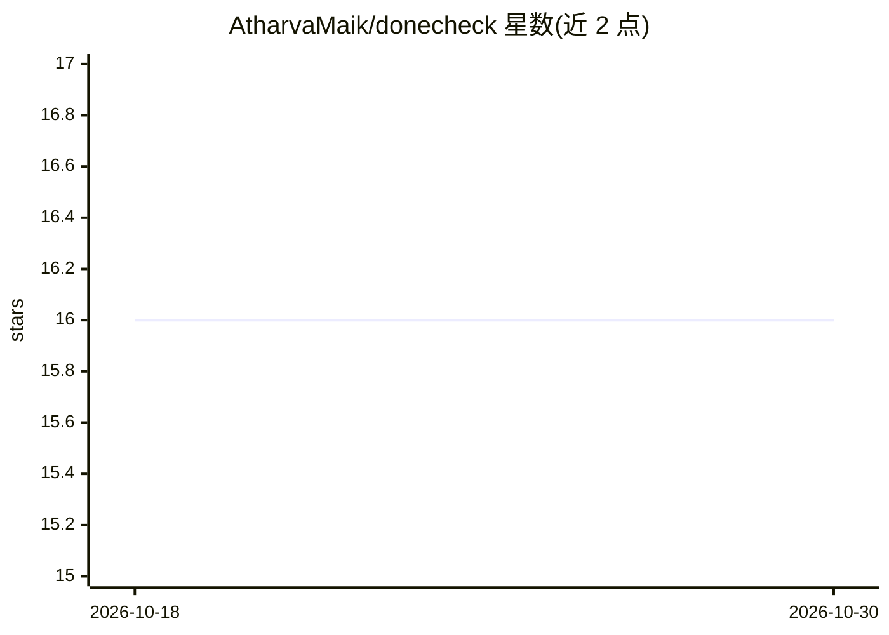

# AtharvaMaik/donecheck

⭐ 16 · Python · MIT · 推送 2026-07-03 · [GitHub](https://github.com/AtharvaMaik/donecheck) · [官网](https://github.com/marketplace/actions/donecheck) · 个人维护

**AI 编码代理的完成度验证门：用证据清单证明工作已完成**

零依赖的 Python CLI 工具，作为 AI 辅助代码变更的 proof-of-done 门禁：扫描变更文件，运行用户指定的验证命令，并生成 DONECHECK.md 证据回执（记录变更文件、发现、命令、退出码与输出）。可检出未完成标记、占位语句、静默跳过、吞异常、误留密钥、不安全 eval/exec 等。支持与 Codex、Claude Code、Cursor、OpenCode 等代理配合使用，并提供 GitHub Action 在 PR 上扫描 diff 并输出错误标注。明确声明不是完整 linter、安全扫描器或测试框架。

## 筛选速览

| 维度 | 判定 | 备注 |
|---|---|---|
| AI 角色 | `ai-ecosystem` | LLM/agent 周边工具 |
| 许可风险 | `permissive` | MIT |
| 部署形态 | `library` | 以包/库形式分发 |
| 模型依赖 | — | README 未给出锁定关系 |
| 硬件要求 | — | 无带数字的原话,不猜 |
| 安装摩擦 | `low` | 无编译、无系统依赖或容器化 |
| 成熟度 | — | 结构信号不足 |

## 能力要点

- 扫描变更文件并运行指定验证命令，生成含退出码与输出的 DONECHECK.md 回执
- 检出未完成标记、吞异常、误留密钥、不安全 eval/exec、静默跳过等
- 提供 GitHub Action：扫描 PR diff、输出错误标注、附加回执到步骤摘要
- 零依赖单文件 Python，可用 pip/pipx 安装或直接 curl 运行

## 适用场景

- 让 AI 编码代理在声称完成前留下可验证证据
- 在 PR 流程中自动拦截 AI 生成代码里的遗留问题
- 人工评审或 CI 之前用低成本门禁过滤明显缺陷

## 场景标签

`代码审查` · 领域:编码与开发

## 证据(README 行号)

> L8: Your AI coding agent says it is done. Make it prove it.
> L12: `donecheck` is a zero-dependency proof-of-done gate for AI-assisted code changes. It scans the changed files, runs 
> L130: ## Why It Exists

## 星数曲线

2026-10-18 16 → 2026-10-30 16（+0）

---
*卡片 v1 · prompt 1.4 · 生成 2026-10-30 · 置信度 high · 依据 README sha `c07cd63e5202` · [字段定义](../../DATASET.md)*
