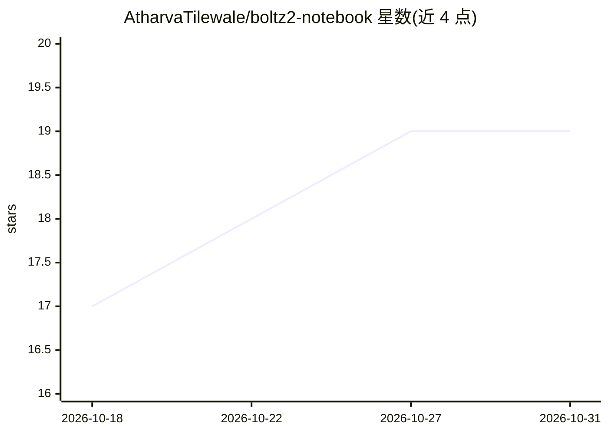

# AtharvaTilewale/boltz2-notebook

⭐ 19 · Python · MIT · 推送 2026-10-27 · [GitHub](https://github.com/AtharvaTilewale/boltz2-notebook) · [官网](https://atharvatilewale.github.io/boltz2-notebook/) · 组织维护

**在浏览器中用 Boltz-2 预测蛋白结构与配体结合亲和力的 Colab 笔记本**

把 Boltz-2 深度学习模型封装为 Google Colab 中的引导式表单：描述蛋白质、DNA/RNA 与小分子配体后运行，输出预测 3-D 结构、置信度指标（pLDDT/PAE/ipTM）、结合亲和力估计（结合概率、预测 IC50/ΔG）与自包含 HTML 报告。提供 Advanced/Standard/Batch 三种笔记本，支持模板、约束、共价键、CSV/FASTA 批量筛选；同套代码也可在本地 Linux 运行。需要 GPU 运行时（T4 或更高），每次会话下载约 6 GB 模型权重；蛋白序列默认发送至 ColabFold MSA 服务器。由 Gujarat Biotechnology University 人员开发，附 bioRxiv 预印本。

## 筛选速览

| 维度 | 判定 | 备注 |
|---|---|---|
| AI 角色 | `ai-native` | 本体是模型或模型工具 |
| 许可风险 | `permissive` | MIT |
| 部署形态 | `library` | 以包/库形式分发 |
| 模型依赖 | — | README 未给出锁定关系 |
| 硬件要求 | — | 无带数字的原话,不猜 |
| 安装摩擦 | `medium` | 含编译或系统依赖之一 |
| 成熟度 | — | 结构信号不足 |

## 能力要点

- 引导式表单输入蛋白质/DNA/RNA/配体，实时校验序列、SMILES 与 CCD 码
- 输出 pLDDT/PAE/ipTM 置信度与结合亲和力（结合概率、预测 IC50、ΔG）
- Batch 笔记本支持从 CSV/FASTA 批量筛选并排序
- 每个任务生成自包含 HTML 报告与复现上下文记录

## 适用场景

- 不做命令行配置，在 Colab 中预测蛋白-配体复合物结构与亲和力
- 虚拟筛选中从 CSV/FASTA 批量运行并对结果排序
- 生成交互式 3-D 结构与置信度报告用于分析或存档

## 场景标签

 · 领域:计算生物学/结构生物学

## 证据(README 行号)

> L13: **Boltz2-Notebook** puts Boltz-2 behind a guided form in Google Colab. Describe your molecules (proteins, DNA, RNA
> L14: and small-molecule ligands), press run, and get a predicted 3-D structure with confidence scores, a binding-affinit
> L162: Developed by Atharva Tilewale and Dr. Dhaval Patel at Gujarat Biotechnology University.

## 星数曲线

2026-10-18 17 → 2026-10-31 19（+2）

---
*卡片 v1 · prompt 1.4 · 生成 2026-10-29 · 置信度 high · 依据 README sha `473ef070514c` · [字段定义](../../DATASET.md)*
