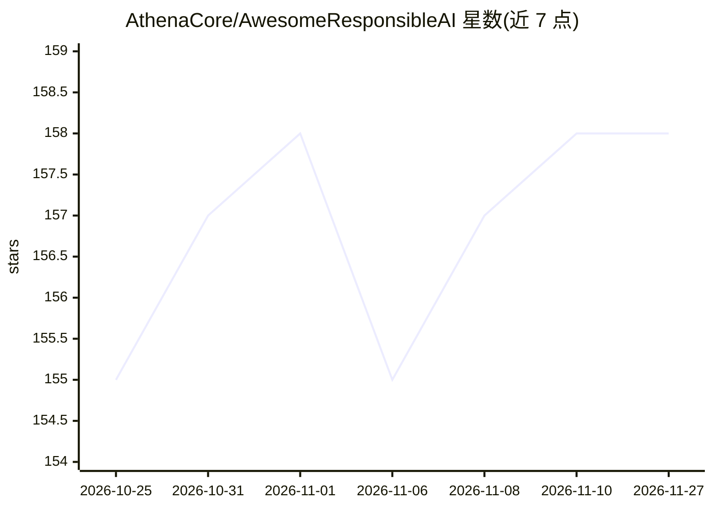

# AthenaCore/AwesomeResponsibleAI

⭐ 158 · MIT · 推送 2026-11-04 · [GitHub](https://github.com/AthenaCore/AwesomeResponsibleAI) · 个人维护

**负责任/可信/以人为本 AI 的学术资源策展清单**

以 awesome list 形式聚合负责任 AI 相关资源，条目类型覆盖学术研究、书籍、伦理准则、课程、数据库与数据集、框架、机构、成熟度模型、通讯、原则、播客、法规、报告、工具与标准；正文先给出 AI 治理、以人为本 AI、开源 AI、负责任 AI、可信 AI 等概念定义，学术研究部分按对抗机器学习、可解释性、公平性、监管、风险、可持续性等主题罗列论文并附出处链接。面向需要检索该领域文献与参考资料的读者。

## 筛选速览

| 维度 | 判定 | 备注 |
|---|---|---|
| AI 角色 | `ai-knowledge` | 知识聚合/清单类 |
| 许可风险 | `permissive` | MIT |
| 部署形态 | `library` | 以包/库形式分发 |
| 模型依赖 | — | README 未给出锁定关系 |
| 硬件要求 | — | 无带数字的原话,不猜 |
| 安装摩擦 | `low` | 无编译、无系统依赖或容器化 |
| 成熟度 | — | 结构信号不足 |

## 能力要点

- 按对抗 ML、可解释性、公平性、监管、风险、可持续性等主题分类收录论文
- 提供 AI 治理/以人为本 AI/开源 AI/负责任 AI/可信 AI 的概念定义章节
- 条目覆盖研究、法规、标准、工具、数据集等 17 类资源

## 适用场景

- 查找负责任 AI 与 AI 治理方向的入门文献
- 调研模型公平性、可解释性、可持续性相关论文
- 了解负责任 AI 领域的法规、标准与工具资源

## 场景标签

`精选清单` `科研工具` · 领域:学习与行业

## 证据(README 行号)

> L8: # Awesome Responsible AI
> L9: A curated list of awesome academic research, books, code of ethics, courses, databases, data sets, frameworks, insti
> L47: ## Academic Research

## 星数曲线

2026-10-25 155 → 2026-11-27 158（+3）

---
*卡片 v1 · prompt 1.4 · 生成 2026-11-27 · 置信度 mid · 依据 README sha `901e3c53d42e` · [字段定义](../../DATASET.md)*
