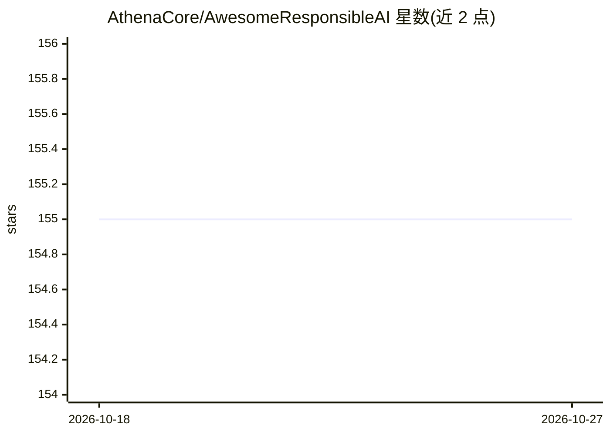

# AthenaCore/AwesomeResponsibleAI

⭐ 155 · MIT · 推送 2026-09-28 · [GitHub](https://github.com/AthenaCore/AwesomeResponsibleAI) · 组织维护

**负责任/可信/以人为本 AI 的学术资源策展清单**

一个 awesome 类策展清单，收录与 Responsible AI、Trustworthy AI、Human-Centered AI 相关的学术研究、书籍、课程、数据集、框架、法规、标准等资源。README 先以问答形式定义 AI 治理、开源 AI、负责任 AI 等核心概念，随后按 Adversarial ML、可解释性、公平性、监管、系统性风险、可持续性等主题组织论文条目，每条附作者、年份、出处与链接。面向从事 AI 伦理、治理与安全研究的学习者和从业者。

## 筛选速览

| 维度 | 判定 | 备注 |
|---|---|---|
| AI 角色 | `ai-knowledge` | 知识聚合/清单类 |
| 许可风险 | `permissive` | MIT |
| 部署形态 | `library` | 以包/库形式分发 |
| 模型依赖 | — | README 未给出锁定关系 |
| 硬件要求 | — | 无带数字的原话,不猜 |
| 安装摩擦 | `low` | 无编译、无系统依赖或容器化 |
| 成熟度 | — | 结构信号不足 |

## 能力要点

- 按 20 余个学术主题组织的论文与研究条目
- 包含 AI 治理、开源 AI、可信 AI 等概念定义问答
- 覆盖公平性审计、可解释性、AI 风险分类、可持续性等方向
- 条目标注来源机构（NIST/IBM Research/Google 等）

## 适用场景

- 查找 AI 公平性、可解释性方向的代表性论文
- 了解负责任 AI 领域的概念框架与术语定义
- 追踪 AI 风险、监管与可持续性研究进展

## 场景标签

`精选清单` · 领域:学习与行业

## 证据(README 行号)

> L9: A curated list of awesome academic research, books, code of ethics, courses, data sets, databases, frameworks, insti
> L47: ## Academic Research

## 星数曲线

2026-10-18 155 → 2026-10-27 155（+0）

---
*卡片 v1 · prompt 1.4 · 生成 2026-10-22 · 置信度 mid · 依据 README sha `fa855723e5e5` · [字段定义](../../DATASET.md)*
