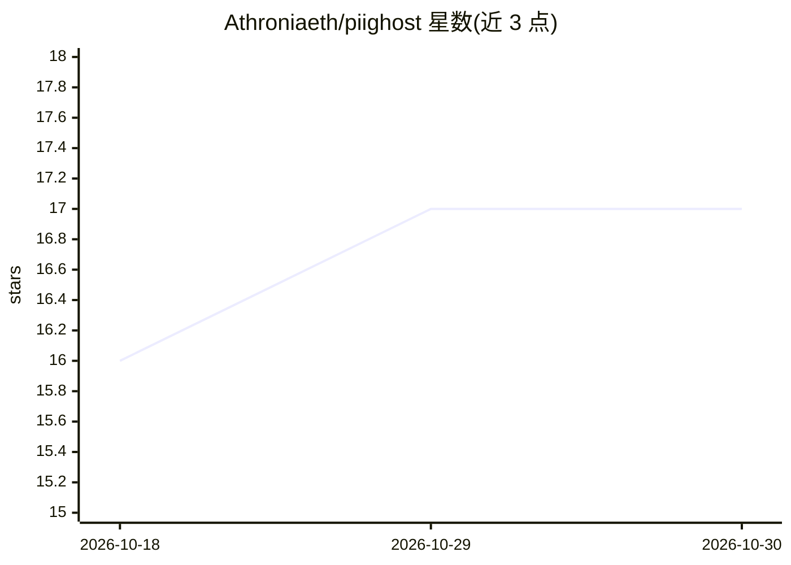

# Athroniaeth/piighost

⭐ 17 · Python · MIT · 推送 2026-10-23 · [GitHub](https://github.com/Athroniaeth/piighost) · [官网](https://piighost.dev) · 个人维护

**LLM 应用的可逆 PII 脱敏库：占位符替换并在回复与工具调用中还原**

Python 库，在数据送入 LLM 前用可插拔检测器（regex、NER、LLM、ExactMatch）识别个人信息与机密，替换为占位符（如 <<EMAIL:1>>），并在回复与工具调用中还原真实值。会话级 pipeline 在整个对话中保持值与占位符的映射，使模型只接触脱敏文本。提供 LangChain、Pydantic AI、LlamaIndex、Claude Code 集成及 OpenAI/Anthropic 兼容代理（piighost-api）。README 注明因保留映射，该机制属 GDPR 下的假名化而非匿名化，真实值在会话期间需受保护。

## 筛选速览

| 维度 | 判定 | 备注 |
|---|---|---|
| AI 角色 | `ai-ecosystem` | LLM/agent 周边工具 |
| 许可风险 | `permissive` | MIT |
| 部署形态 | `library` | 以包/库形式分发 |
| 模型依赖 | — | README 未给出锁定关系 |
| 硬件要求 | — | 无带数字的原话,不猜 |
| 安装摩擦 | `low` | 无编译、无系统依赖或容器化 |
| 成熟度 | — | 结构信号不足 |

## 能力要点

- 可插拔检测器：ExactMatch、regex、NER、LLM
- 会话级 pipeline 跨消息保持占位符映射一致
- LangChain 中间件：LLM 只见占位符，工具收到真实值
- piighost-api 提供 OpenAI/Anthropic 兼容代理部署

## 适用场景

- 企业 agent 接入 LLM 前对个人信息与机密做脱敏
- GDPR 合规场景下保留对话上下文的假名化处理
- 通过 API 代理为现有 LLM 应用无侵入接入脱敏

## 场景标签

 · 领域:LLM 隐私/数据脱敏

## 证据(README 行号)

> L13: `piighost` replaces personal data with placeholders before the LLM sees it, then restores the real values in the re
> L24: The same mechanism protects agents that call tools. With the LangChain middleware, a tool that needs the real email

## 星数曲线

2026-10-18 16 → 2026-10-30 17（+1）

---
*卡片 v1 · prompt 1.4 · 生成 2026-10-30 · 置信度 high · 依据 README sha `25da2f541d53` · [字段定义](../../DATASET.md)*
