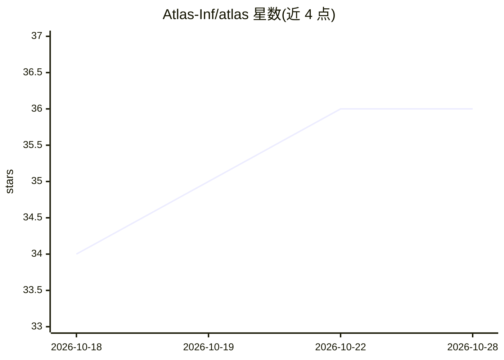

# Atlas-Inf/atlas

⭐ 36 · Rust · AGPL-3.0 · 推送 2026-10-27 · [GitHub](https://github.com/Atlas-Inf/atlas) · [官网](https://atlasinference.dev) · 组织维护

**纯 Rust/CUDA 的 LLM 本地推理引擎，面向工作站硬件**

Atlas 是用纯 Rust 与 CUDA 编写的 LLM 推理引擎，以单一紧凑二进制发布，无 Python 与 PyTorch 依赖，面向 NVIDIA DGX Spark/GB10 与 AMD Strix Halo 等工作站硬件。提供按硬件与模型组合定制的微内核、MTP/DSpark 等投机解码、NVMe 权重流式加载，支持数十个已验证模型配方（sparkrun run @atlas/<recipe>）。同一端口提供 OpenAI、Anthropic 与 Responses 兼容 API。当前支持 GB10 与 Strix Halo（Linux/Windows 原生 HIP），Apple Silicon 与 Intel 为后续计划。

## 筛选速览

| 维度 | 判定 | 备注 |
|---|---|---|
| AI 角色 | `ai-ecosystem` | LLM/agent 周边工具 |
| 许可风险 | `dual` | AGPL-3.0 |
| 部署形态 | `desktop` | 安装包/桌面程序 |
| 模型依赖 | locked-api |  |
| 硬件要求 | — | 无带数字的原话,不猜 |
| 安装摩擦 | `medium` | 含编译或系统依赖之一 |
| 成熟度 | — | 结构信号不足 |

## 能力要点

- 单二进制、无 Python/PyTorch 依赖，启动时按 config.json 选内核
- OpenAI/Anthropic/Responses 兼容 API，支持流式、工具调用与推理轨迹
- sparkrun 验证配方一键启动模型，支持 NVMe 流式加载 ~180B MoE 模型
- GB10 与 Strix Halo 双平台支持（Linux/Windows 原生 HIP）

## 适用场景

- 在 DGX Spark/GB10 或 Strix Halo 工作站上本地部署 LLM 服务
- 用 OpenAI/Anthropic 兼容端点接入现有客户端与工具链
- 通过验证配方快速运行 Qwen、Nemotron 等模型并做投机解码

## 场景标签

`推理引擎` · 领域:训练与推理

## 证据(README 行号)

> L27: Atlas is a high-performance, pure Rust & CUDA LLM inference engine purpose-built for prosumer workstations (NVIDIA 
> L34: - **OpenAI & Anthropic Compatible**: Drop-in API endpoint supporting streaming, tool calling, and reasoning traces.

## 星数曲线

2026-10-18 34 → 2026-10-28 36（+2）

---
*卡片 v1 · prompt 1.4 · 生成 2026-10-25 · 置信度 high · 依据 README sha `7578202bfc7d` · [字段定义](../../DATASET.md)*
