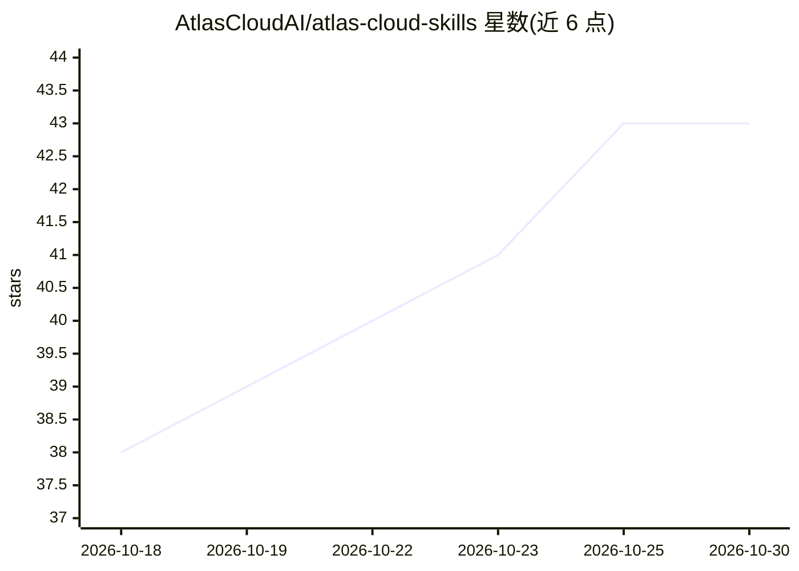

# AtlasCloudAI/atlas-cloud-skills

⭐ 43 · JavaScript · 推送 2026-10-29 · [GitHub](https://github.com/AtlasCloudAI/atlas-cloud-skills) · [官网](https://www.atlascloud.ai) · 组织维护 · 中文 README

**让编码 Agent 调用 Atlas Cloud 300+ 模型的技能包**

Atlas Cloud 官方维护的 agent 技能包，供 Claude Code、Codex、Gemini CLI 等编码 Agent 通过一个 API key 调用 505 个模型（视频 230、图像 138、LLM 78、3D 14、音频 13），能力包括生图、生视频、LLM 对话、语音合成与识别、3D 生成、媒体上传。包含三个技能：atlas-cloud 主技能（9 个 MCP 工具文档与 Python/TS/cURL 模板）、Seedance 2.5 专属视频子技能、跨模型通用视频 prompt 规格技能，后两者附中英文参考。提供 npx、shell 脚本与手动安装方式，另可接 MCP Server 支持 Cursor、VS Code 等 14 类客户端。

## 筛选速览

| 维度 | 判定 | 备注 |
|---|---|---|
| AI 角色 | `ai-ecosystem` | LLM/agent 周边工具 |
| 许可风险 | `none` | — |
| 部署形态 | `library` | 以包/库形式分发 |
| 模型依赖 | — | README 未给出锁定关系 |
| 硬件要求 | — | 无带数字的原话,不猜 |
| 安装摩擦 | `low` | 无编译、无系统依赖或容器化 |
| 成熟度 | — | 结构信号不足 |

## 能力要点

- 一个 API key 接入 505 个模型（视频/图像/LLM/3D/音频）
- atlas-cloud 主技能文档化 9 个 MCP 工具并提供 Python/Node/cURL 模板
- seedance-2-5-skill 与 universal-video-prompt-skill 支持跨模型视频 prompt 规格与降级报告
- 支持 14 类 MCP 兼容客户端（Cursor、VS Code、JetBrains 等）

## 适用场景

- 在 Claude Code / Codex / Gemini CLI 中直接生成图像与视频
- 用同一份视频 prompt 规格在多个模型间复用与对比
- 通过 MCP Server 在 IDE 中调用 Atlas Cloud 全部模型

## 场景标签

`图像生成` `视频生成` `语音合成` · 领域:内容生成

## 证据(README 行号)

> L15: Use Atlas Cloud's 300+ image / video / LLM models inside Claude Code, Codex, Gemini CLI, and other AI coding agents
> L47: - Complete API reference for image generation, video generation, LLM chat, media upload, and quick generation
> L130: ## MCP Server

## 星数曲线

2026-10-18 38 → 2026-10-30 43（+5）

---
*卡片 v1 · prompt 1.4 · 生成 2026-10-25 · 置信度 high · 依据 README sha `1711e8eb90df` · [字段定义](../../DATASET.md)*
