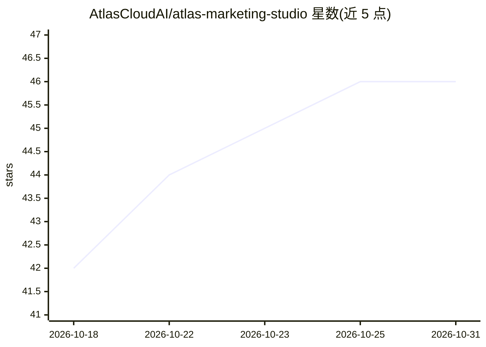

# AtlasCloudAI/atlas-marketing-studio

⭐ 46 · TypeScript · 推送 2026-10-16 · [GitHub](https://github.com/AtlasCloudAI/atlas-marketing-studio) · [官网](https://atlas-saas-starter.atlascloudai.workers.dev/) · 组织维护

**面向电商的 AI 视频广告生成工作室，可自托管**

开源的电商 AI 广告生成应用，由 Atlas Cloud 提供多模型编排（图像、视频、LLM、TTS、唇形同步）。提供四条工作流：UGC 产品广告、参考广告翻拍、AI 短剧广告与双人广告短剧，输入支持中英文等多语言自动检测。面向电商团队、代理与开发者，内置积分计费、Google 登录、Stripe 充值，可部署到 Vercel 或 Cloudflare Workers（数据库可选 Neon/D1，存储可选 Blob/R2）。运行需 Atlas Cloud API key。

## 筛选速览

| 维度 | 判定 | 备注 |
|---|---|---|
| AI 角色 | `ai-native` | 本体是模型或模型工具 |
| 许可风险 | `permissive` | — |
| 部署形态 | `library` | 以包/库形式分发 |
| 模型依赖 | — | README 未给出锁定关系 |
| 硬件要求 | — | 无带数字的原话,不猜 |
| 安装摩擦 | `low` | 无编译、无系统依赖或容器化 |
| 成熟度 | — | 结构信号不足 |

## 能力要点

- 四条 AI 广告工作流：UGC 广告/参考翻拍/短剧广告/双人短剧
- 多模型编排（图像、视频、LLM、TTS、唇形同步）经 Atlas Cloud API
- 视频积分动态定价（按时长/模型/分辨率）与充值包配置
- 同一代码可部署 Vercel 或 Cloudflare Workers（D1/R2 或 Neon/Blob）

## 适用场景

- 电商卖家从产品图快速产出 UGC 视频广告变体
- 投放团队用参考广告翻拍生成适配自家产品的新素材
- 开发者参考其搭建带计费与登录的 AI 视频 SaaS

## 场景标签

`视频生成` `图像生成` `语音合成` · 领域:内容生成

## 证据(README 行号)

> L3: **Marketing Studio** is an open-source AI e-commerce ad studio for generating UGC product ads, reference-ad remakes,
> L17: Marketing Studio is a self-hostable AI ad generator for e-commerce teams, agencies, and builders, powered by Atlas 
> L36: |**UGC Product Ad**|Product + presenter photos -> lip-synced UGC ad|An **AI UGC ad generator** or **product-to-vide

## 星数曲线

2026-10-18 42 → 2026-10-31 46（+4）

---
*卡片 v1 · prompt 1.4 · 生成 2026-10-25 · 置信度 high · 依据 README sha `174d2d1012df` · [字段定义](../../DATASET.md)*
