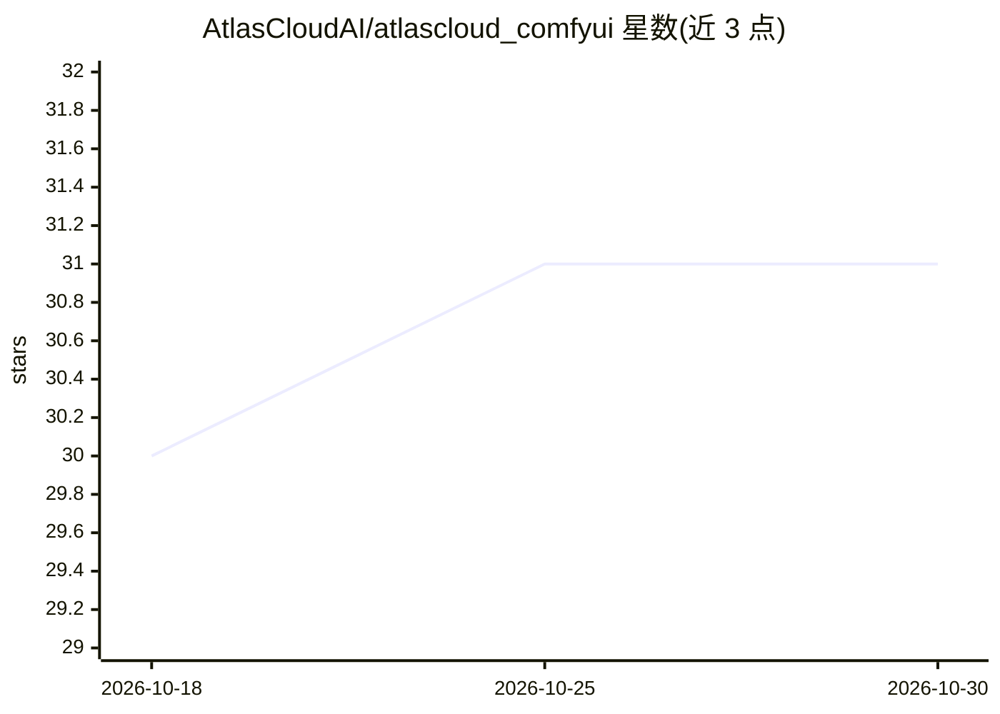

# AtlasCloudAI/atlascloud_comfyui

⭐ 31 · Python · MIT · 推送 2026-09-22 · [GitHub](https://github.com/AtlasCloudAI/atlascloud_comfyui) · [官网](https://www.atlascloud.ai) · 组织维护

**ComfyUI 节点包：经 Atlas Cloud API 调用 300+ 图像/视频模型**

Atlas Cloud 官方维护的 ComfyUI 自定义节点包：通过 AtlasCloud Client 节点配置 API key 与 base URL，在 ComfyUI 内以节点形式调用云端 300+ 模型，覆盖文生视频、图生视频、视频编辑、文生图等任务，接入 Sora 2、Veo 3.1、Kling、Seedance、Nano Banana Pro、GPT Image 2 等模型。生成在云端完成，无需本地 GPU 或模型权重。安装方式为 git clone 到 custom_nodes 并在 ComfyUI 的 Python 环境中安装依赖。部分旧模型节点已标记 Deprecated，默认运行时报错，需设置环境变量 ATLAS_ALLOW_DEPRECATED_MODELS=1 才可用。

## 筛选速览

| 维度 | 判定 | 备注 |
|---|---|---|
| AI 角色 | `ai-ecosystem` | LLM/agent 周边工具 |
| 许可风险 | `permissive` | MIT |
| 部署形态 | `library` | 以包/库形式分发 |
| 模型依赖 | — | README 未给出锁定关系 |
| 硬件要求 | — | 无带数字的原话,不猜 |
| 安装摩擦 | `low` | 无编译、无系统依赖或容器化 |
| 成熟度 | — | 结构信号不足 |

## 能力要点

- 以 ComfyUI 节点形式调用 Atlas Cloud 300+ 云端模型
- 覆盖文生视频/图生视频/参考图生视频/视频编辑/文生图等任务
- 生成在云端完成，无需本地 GPU 或模型权重
- 提供 AtlasCloud Client 节点统一管理 API key 与 base URL

## 适用场景

- 在 ComfyUI 工作流中直接调用 Sora 2、Veo 3.1 等视频生成模型
- 无本地 GPU 的情况下搭建文生图/文生视频工作流
- 用同一 API key 在 ComfyUI 中切换多家厂商的图像视频模型

## 场景标签

`图像生成` `视频生成` · 领域:内容生成

## 证据(README 行号)

> L3: > Use Atlas Cloud's 300+ AI models inside ComfyUI. Drop-in nodes for Sora 2, Veo 3.1, Kling 3, Seedance 2, Nano Bana
> L32: 3. Open the **AtlasCloud Client** node and paste your API key.
> L90: - **AtlasCloud Client** — Stores your API key and base URL for all Atlas Cloud nodes.

## 星数曲线

2026-10-18 30 → 2026-10-30 31（+1）

---
*卡片 v1 · prompt 1.4 · 生成 2026-10-26 · 置信度 mid · 依据 README sha `60d03b19dd78` · [字段定义](../../DATASET.md)*
