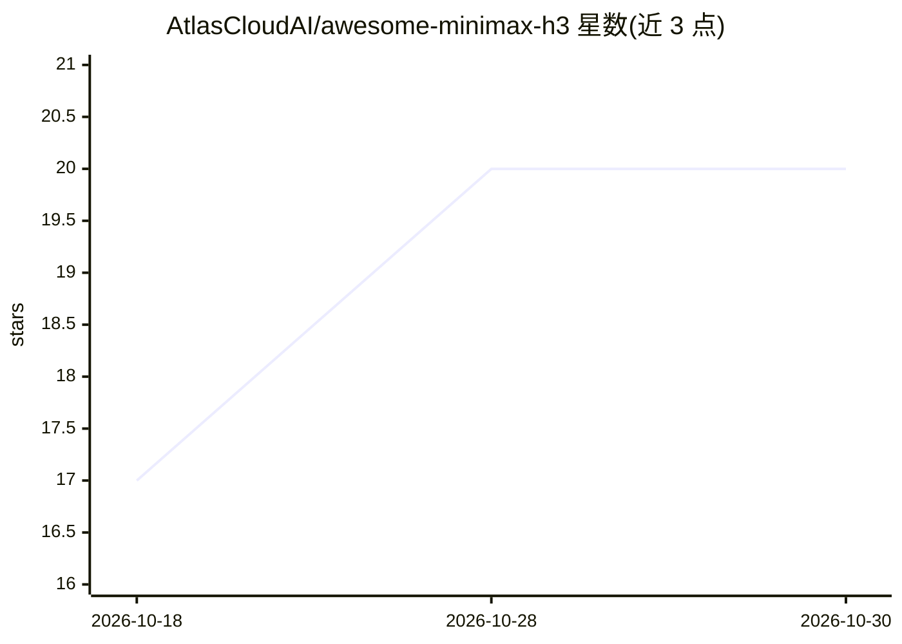

# AtlasCloudAI/awesome-minimax-h3

⭐ 20 · Python · NOASSERTION · 推送 2026-10-29 · [GitHub](https://github.com/AtlasCloudAI/awesome-minimax-h3) · 组织维护 · 中文 README

**MiniMax H3 开源生态策展清单：权重、量化、LoRA 与工具**

围绕 MiniMax H3 全模态视频模型（图文与原生音频联合生成）的 awesome list：仅收录 H3 相关条目，覆盖官方权重与 API、ComfyUI 节点与模板、vLLM/SGLang/diffusers 服务方案、Mac 原生与低显存运行、GGUF/NVFP4 量化与剪枝打包、Turbo LoRA 加速、注意力缓存、LoRA 训练路径及社区技巧。条目标注星数、下载量与核验日期，声明每条链接经 API 核验；含披露条目（维护方自营的托管 API）。

## 筛选速览

| 维度 | 判定 | 备注 |
|---|---|---|
| AI 角色 | `ai-knowledge` | 知识聚合/清单类 |
| 许可风险 | `none` | NOASSERTION |
| 部署形态 | `None` |  |
| 模型依赖 | — | README 未给出锁定关系 |
| 硬件要求 | — | 无带数字的原话,不猜 |
| 安装摩擦 | `medium` | 含编译或系统依赖之一 |
| 成熟度 | — | 结构信号不足 |

## 能力要点

- 按运行/装进显存/加速/LoRA 训练/技巧组织的分区结构
- 条目附星数、下载量与核验日期，声明逐条对 live API 核验
- 收录 123.6GB 原始权重到 42.5GB 以下的剪枝/量化路线
- 范围限定 H3 本体，非 H3 项目不予收录

## 适用场景

- 查找 H3 的本地运行方案（ComfyUI、Mac 原生、低显存打包）
- 挑选合适的量化或剪枝权重以适配自己的显卡
- 寻找加速手段（Turbo LoRA、缓存、注意力内核）与 LoRA 训练路径

## 场景标签

`精选清单` `视频生成` · 领域:内容生成

## 证据(README 行号)

> L5: > Everything built on top of MiniMax H3 — the open-weight omni-modal video model that generates picture and native a
> L9: **Scope: H3 only.** MiniMax ships plenty besides H3 — the M-series LLMs, Music, an agent stack with more stars than 

## 星数曲线

2026-10-18 17 → 2026-10-30 20（+3）

---
*卡片 v1 · prompt 1.4 · 生成 2026-10-28 · 置信度 high · 依据 README sha `75b09dad78e9` · [字段定义](../../DATASET.md)*
