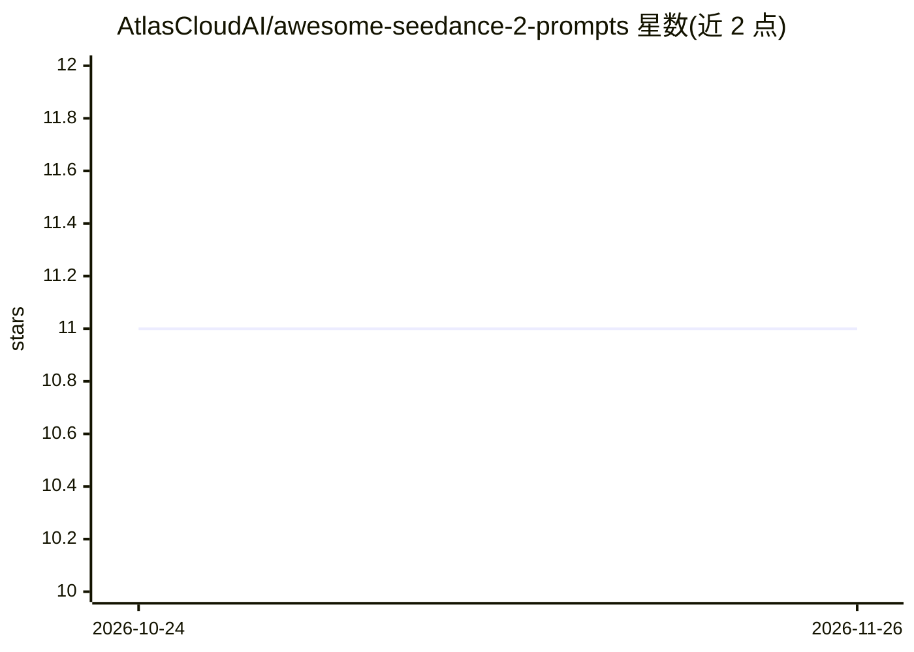

# AtlasCloudAI/awesome-seedance-2-prompts

⭐ 11 · TypeScript · NOASSERTION · 推送 2026-11-25 · [GitHub](https://github.com/AtlasCloudAI/awesome-seedance-2-prompts) · [官网](https://www.atlascloud.ai) · 组织维护 · 中文 README

**Seedance 2.0 视频生成提示词合集（2706 条，含预览视频）**

按 CC BY 4.0 许可分享的 Seedance 2.0 视频提示词策展清单，收录 2706 条提示词、分 11 个类别，附 1597 个经 Atlas Cloud 生成的预览视频与来源链接。正文提供提示词结构说明（主体/动作/镜头/风格）、进阶公式、特殊符号约定（音乐、音效、对白、字幕）与常见问题对照（角色漂移、水印、接缝处理）。支持 18 种语言界面，提供 Prompt Library 与模型页面的 AtlasCloud 在线入口。

## 筛选速览

| 维度 | 判定 | 备注 |
|---|---|---|
| AI 角色 | `ai-knowledge` | 知识聚合/清单类 |
| 许可风险 | `none` | NOASSERTION |
| 部署形态 | `None` |  |
| 模型依赖 | — | README 未给出锁定关系 |
| 硬件要求 | — | 无带数字的原话,不猜 |
| 安装摩擦 | `low` | 无编译、无系统依赖或容器化 |
| 成熟度 | — | 结构信号不足 |

## 能力要点

- 2706 条提示词、11 个分类，1597 个实际生成的预览视频
- 进阶公式与特殊符号约定（音乐（）/音效<>/对白{}/字幕【】）
- 常见问题对照：角色漂移、字幕水印、接缝处理等规避方法
- 提供 18 种语言界面与 AtlasCloud 在线 Prompt Library

## 适用场景

- 为 Seedance 2.0 视频生成查找可复用的提示词模板
- 学习参考图/视频/音频占位符的提示词写法
- 广告创意、MV 制作、短视频叙事的灵感检索

## 场景标签

`精选清单` `视频生成` · 领域:内容生成

## 证据(README 行号)

> L9: > A curated collection of Seedance 2.0 video prompts — each with real previews generated via Atlas Cloud. Cinematic,
> L74: |Total Prompts|**2706**|
> L79: ## 🏷️ Browse by Category

## 星数曲线

2026-10-24 11 → 2026-11-26 11（+0）

---
*卡片 v1 · prompt 1.4 · 生成 2026-11-19 · 置信度 high · 依据 README sha `073b958abdd3` · [字段定义](../../DATASET.md)*
