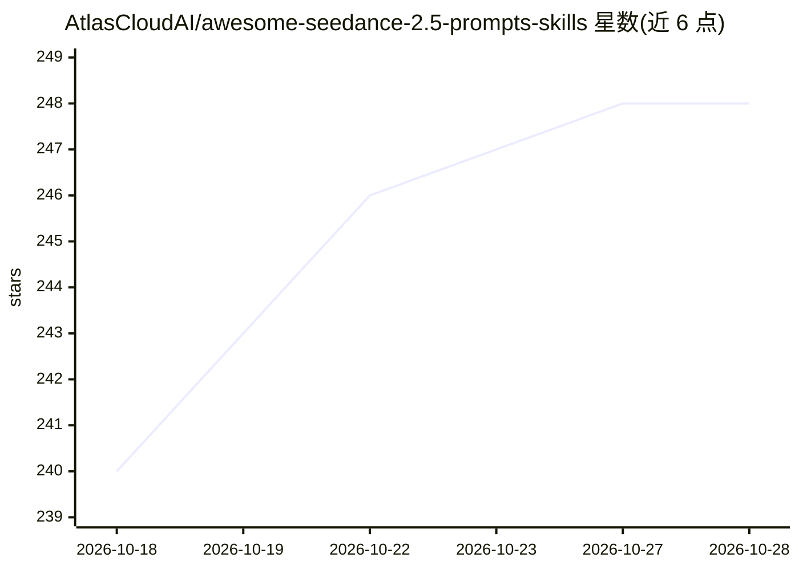

# AtlasCloudAI/awesome-seedance-2.5-prompts-skills

⭐ 248 · TypeScript · NOASSERTION · 推送 2026-10-27 · [GitHub](https://github.com/AtlasCloudAI/awesome-seedance-2.5-prompts-skills) · [官网](https://www.atlascloud.ai/prompts-hub/seedance-2-5-prompt?utm_source=github&utm_campaign=awesome-seedance-2.5-prompts-skills) · 组织维护 · 中文 README

**Seedance 2.5 视频提示词库与可安装视频生成 Agent Skill**

由 Atlas Cloud 维护的 Seedance 2.5 视频提示词策展库（150 条提示词、33 个分类、50 个预览视频），附带可安装的 Agent Skill：将创意简报或现有提示词改写为生产级 Seedance 提示词，按需用 Seedream 5.0 Pro 生成并审校分镜图，再经所选 Atlas 渠道提交视频生成任务并轮询至完成。当前默认执行模型为 Seedance 2.0，仅在所选服务商暴露 Seedance 2.5 时切换。另有模型无关的 Universal Video Prompt Skill 支持跨模型编译同一提示词规格。

## 筛选速览

| 维度 | 判定 | 备注 |
|---|---|---|
| AI 角色 | `ai-native` | 本体是模型或模型工具 |
| 许可风险 | `none` | NOASSERTION |
| 部署形态 | `library` | 以包/库形式分发 |
| 模型依赖 | — | README 未给出锁定关系 |
| 硬件要求 | — | 无带数字的原话,不猜 |
| 安装摩擦 | `low` | 无编译、无系统依赖或容器化 |
| 成熟度 | — | 结构信号不足 |

## 能力要点

- 150 条提示词、33 个分类、50 个预览视频，记录来源平台/作者/链接
- Skill 可改写提示词、按需生成分镜图并自动审校质量
- 经 Atlas Cloud Skill/MCP/CLI/REST 提交生成任务，2 秒轮询同一任务 ID 至完成
- Universal Video Prompt Skill 编写模型无关提示词规格并跨模型编译

## 适用场景

- 浏览和复用带真实预览的 Seedance 视频提示词
- 把创意简报或参考图改写成可执行的生产级视频提示词
- 需要多镜头分镜规划时自动生成并审校分镜图

## 场景标签

`视频生成` `提示工程` `精选清单` · 领域:Agent 开发

## 证据(README 行号)

> L9: A curated library of Seedance 2.5 video prompts plus **Seedance 2.5 Skill**, an installable Agent Skill that improve
> L44: **Seedance 2.5 Skill** is the name of the installable Agent Skill in this repository. It turns a creative brief, ex
> L58: - **Improve prompts:** turn an idea, an existing prompt, or reference assets into a clearer production-ready Seedan

## 星数曲线

2026-10-18 240 → 2026-10-28 248（+8）

---
*卡片 v1 · prompt 1.4 · 生成 2026-10-22 · 置信度 mid · 依据 README sha `69d2b1589482` · [字段定义](../../DATASET.md)*
