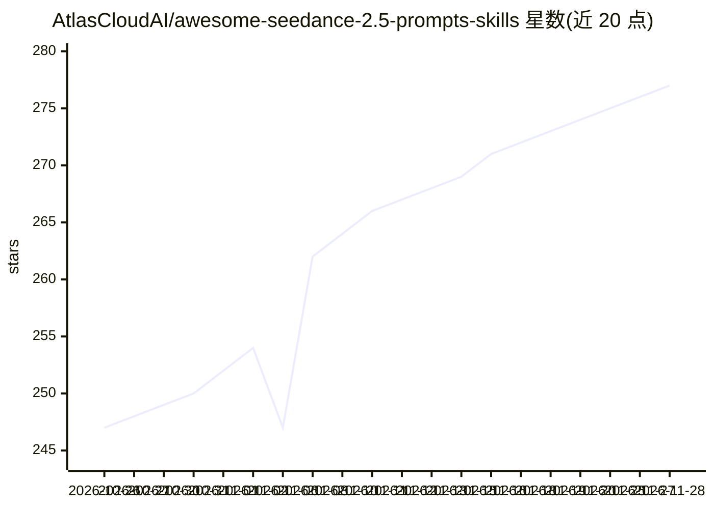

# AtlasCloudAI/awesome-seedance-2.5-prompts-skills

⭐ 277 · TypeScript · NOASSERTION · 推送 2026-11-27 · [GitHub](https://github.com/AtlasCloudAI/awesome-seedance-2.5-prompts-skills) · [官网](https://www.atlascloud.ai/prompts-hub/seedance-2-5-prompt?utm_source=github&utm_campaign=awesome-seedance-2.5-prompts-skills) · 组织维护 · 中文 README

**为视频创作者提供 Seedance 提示词库与可安装的生成工作流 Skill**

包含两部分：一是收录 150 条 Seedance 视频生成提示词的清单（33 个分类、50 个预览视频），每条保留分类、来源、作者与预览；二是可安装的 Agent Skill，将创意简报或已有提示词改写为生产可用提示词，需要时用 Seedream 5.0 Pro 生成分镜图并自动审查，再经 Atlas Cloud 通道提交视频生成任务并轮询结果。默认可执行模型为 Seedance 2.0，仅在所选 provider 提供时切换到 Seedance 2.5；提供跨模型通用的 Universal Video Prompt Skill。需 Atlas Cloud API key。

## 筛选速览

| 维度 | 判定 | 备注 |
|---|---|---|
| AI 角色 | `ai-native` | 本体是模型或模型工具 |
| 许可风险 | `none` | NOASSERTION |
| 部署形态 | `library` | 以包/库形式分发 |
| 模型依赖 | — | README 未给出锁定关系 |
| 硬件要求 | — | 无带数字的原话,不猜 |
| 安装摩擦 | `low` | 无编译、无系统依赖或容器化 |
| 成熟度 | `idea` | |

## 能力要点

- 150 条提示词按 33 个分类组织，附 50 个真实预览视频与来源溯源
- Skill 生成生产级提示词、分镜审查与视频生成执行的完整工作流
- Universal Video Prompt Skill 将模型无关的提示词规范编译到可调用的视频模型
- 异步任务按 prediction ID 轮询，防止重复付费提交

## 适用场景

- 查找并复用带预览效果的 Seedance 视频提示词
- 把一个创意简报改写为适配所选视频模型的生产级提示词
- 需要多镜头规划时自动生成分镜并审查后再生成视频
- 同一简报在多个视频模型之间切换或对比

## 场景标签

`提示工程` `视频生成` `精选清单` · 领域:Agent 开发

## 证据(README 行号)

> L9: A curated library of Seedance 2.5 video prompts plus **Seedance 2.5 Skill**, an installable Agent Skill that improve
> L44: **Seedance 2.5 Skill** is the name of the installable Agent Skill in this repository. It turns a creative brief, ex
> L117: **Storyboard stills:** Seedream 5.0 Pro. **Executable video default:** Seedance 2.0. **Seedance 2.5:** only when t

## 星数曲线

2026-10-26 247 → 2026-11-28 277（+30）

---
*卡片 v1 · prompt 1.4 · 生成 2026-11-27 · 置信度 high · 依据 README sha `3b73209eba12` · [字段定义](../../DATASET.md)*
