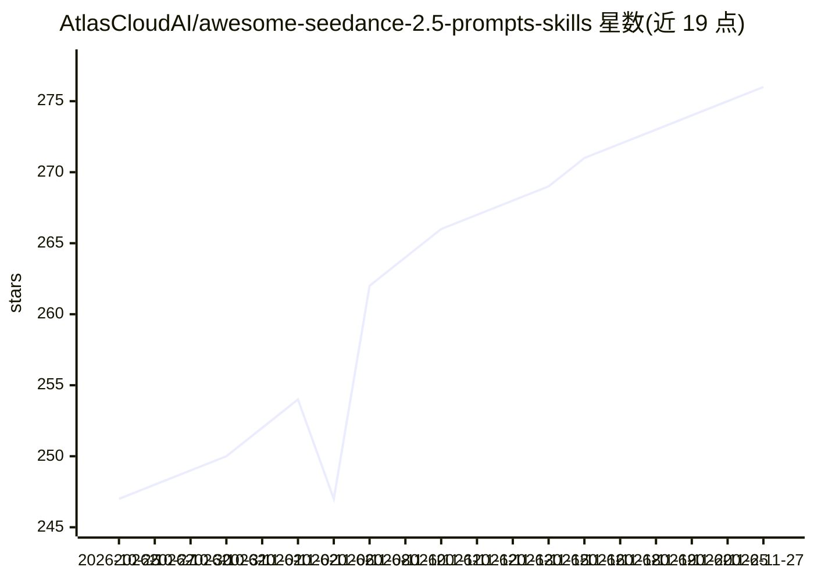

# AtlasCloudAI/awesome-seedance-2.5-prompts-skills

⭐ 276 · TypeScript · NOASSERTION · 推送 2026-11-26 · [GitHub](https://github.com/AtlasCloudAI/awesome-seedance-2.5-prompts-skills) · [官网](https://www.atlascloud.ai/prompts-hub/seedance-2-5-prompt?utm_source=github&utm_campaign=awesome-seedance-2.5-prompts-skills) · 组织维护 · 中文 README

**Seedance 2.5 视频提示词库与可安装的视频生成 Agent 技能**

仓库包含两部分：150 条经整理的 Seedance 2.5 视频提示词（33 个分类、50 个真实预览视频，每条保留分类、来源平台、作者与源链接），以及可安装的 Agent Skill——将创意简报或已有提示词转化为可执行提示词，按需用 Seedream 5.0 Pro 生成分镜图并自动审查，经 Atlas Cloud 通道提交视频生成并轮询任务到完成。另附模型无关的 Universal Video Prompt Skill，可将同一规格编译到可调用的不同视频模型。视频默认用 Seedance 2.0，仅在所选提供方实际开放 Seedance 2.5 时切换。

## 筛选速览

| 维度 | 判定 | 备注 |
|---|---|---|
| AI 角色 | `ai-native` | 本体是模型或模型工具 |
| 许可风险 | `none` | NOASSERTION |
| 部署形态 | `library` | 以包/库形式分发 |
| 模型依赖 | — | README 未给出锁定关系 |
| 硬件要求 | — | 无带数字的原话,不猜 |
| 安装摩擦 | `low` | 无编译、无系统依赖或容器化 |
| 成熟度 | — | 结构信号不足 |

## 能力要点

- 150 条提示词按 33 个分类组织，附 50 个真实预览视频与来源记录
- npx 安装的 Agent Skill：优化提示词、规划并自动审查分镜、生成视频
- Universal Video Prompt Skill 支持一份规格跨多个视频模型编译执行
- 七段式提示词结构指南（引用绑定/动作/空间/镜头/风格/音频/约束）

## 适用场景

- 查找并复用带真实预览的 Seedance 视频提示词
- 在 Agent 对话中从创意简报直接生成视频成片
- 同一创意需求在多个视频模型间切换执行

## 场景标签

`视频生成` `精选清单` · 领域:内容生成

## 证据(README 行号)

> L9: A curated library of Seedance 2.5 video prompts plus **Seedance 2.5 Skill**, an installable Agent Skill that improve
> L44: **Seedance 2.5 Skill** is the name of the installable Agent Skill in this repository. It turns a creative brief, ex
> L51: npx skills add AtlasCloudAI/awesome-seedance-2.5-prompts-skills --skill seedance-2-5-skill

## 星数曲线

2026-10-25 247 → 2026-11-27 276（+29）

---
*卡片 v1 · prompt 1.4 · 生成 2026-11-26 · 置信度 high · 依据 README sha `52965f72cd98` · [字段定义](../../DATASET.md)*
