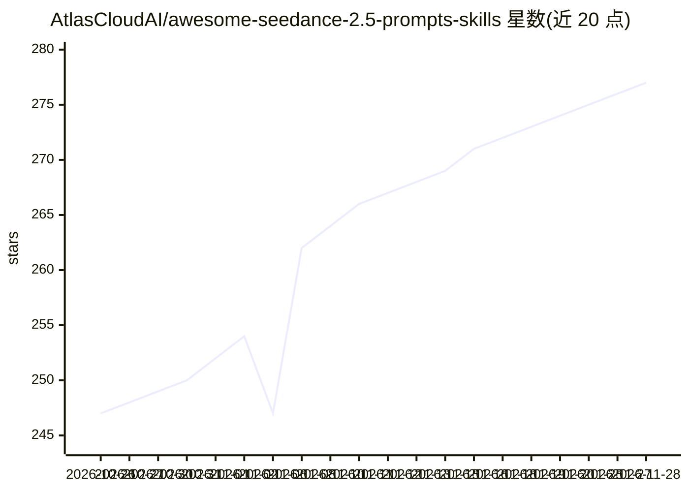

# AtlasCloudAI/awesome-seedance-2.5-prompts-skills

⭐ 277 · TypeScript · NOASSERTION · 推送 2026-11-27 · [GitHub](https://github.com/AtlasCloudAI/awesome-seedance-2.5-prompts-skills) · [官网](https://www.atlascloud.ai/prompts-hub/seedance-2-5-prompt?utm_source=github&utm_campaign=awesome-seedance-2.5-prompts-skills) · 组织维护 · 中文 README

**Seedance 2.5 视频提示词库与配套 Agent Skill 安装包**

收录 150 条 Seedance 2.5 视频生成提示词，分 33 类并附 50 个真实预览视频，每条记录类别、来源平台、作者与链接。仓库同时提供可安装的 Seedance 2.5 Agent Skill：将创意简报或现有提示词改写为生产可用提示词，按需用 Seedream 5.0 Pro 生成分镜并自动评审，再经 Atlas Cloud 通道提交生成任务并轮询结果。执行默认视频模型为 Seedance 2.0，Seedance 2.5 仅在所选 provider 实际开放时调用；模型于 2026 年 8 月发布，能力以公告口径记录。

## 筛选速览

| 维度 | 判定 | 备注 |
|---|---|---|
| AI 角色 | `ai-knowledge` | 知识聚合/清单类 |
| 许可风险 | `none` | NOASSERTION |
| 部署形态 | `library` | 以包/库形式分发 |
| 模型依赖 | — | README 未给出锁定关系 |
| 硬件要求 | — | 无带数字的原话,不猜 |
| 安装摩擦 | `low` | 无编译、无系统依赖或容器化 |
| 成熟度 | — | 结构信号不足 |

## 能力要点

- 150 条提示词、33 个类别、50 个预览视频，保留来源与出处信息
- npx skills add 安装 Agent Skill，含 7 步提示词结构与多个参考文档
- Universal Video Prompt Skill 支持一份跨模型规格编译到不同视频模型
- 异步任务按同一 prediction ID 每 2 秒轮询，避免重复付费提交

## 适用场景

- 按类别浏览并复制带预览的视频生成提示词
- 让 Skill 将简报改写为适配目标模型的提示词并生成视频
- 在多个视频模型间复用同一份提示词规格做对比

## 场景标签

`提示工程` `视频生成` `精选清单` · 领域:Agent 开发

## 证据(README 行号)

> L9: A curated library of Seedance 2.5 video prompts plus **Seedance 2.5 Skill**, an installable Agent Skill that improve
> L107: 1. **Browse:** filter by category, open a real preview when available, and copy the prompt.

## 星数曲线

2026-10-26 247 → 2026-11-28 277（+30）

---
*卡片 v1 · prompt 1.4 · 生成 2026-11-28 · 置信度 high · 依据 README sha `e11173cdf2b4` · [字段定义](../../DATASET.md)*
