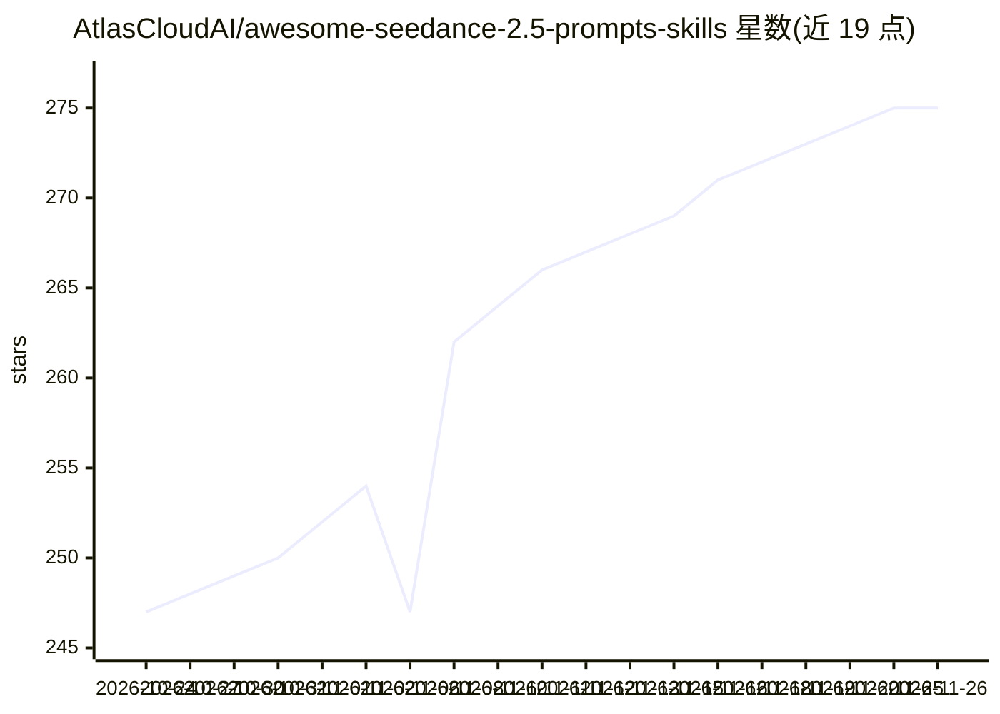

# AtlasCloudAI/awesome-seedance-2.5-prompts-skills

⭐ 275 · TypeScript · NOASSERTION · 推送 2026-11-25 · [GitHub](https://github.com/AtlasCloudAI/awesome-seedance-2.5-prompts-skills) · [官网](https://www.atlascloud.ai/prompts-hub/seedance-2-5-prompt?utm_source=github&utm_campaign=awesome-seedance-2.5-prompts-skills) · 组织维护

**Seedance 2.5 视频提示词库（150条）+ 可安装的视频生成 Agent Skill**

仓库由两部分组成：一是收录 150 条 Seedance 2.5 视频提示词的策展库，按 33 个类别组织，附 50 个真实预览视频，每条保留来源平台、作者与输入引用；二是可安装的 Agent Skill，将创意简报或既有提示词改写为生产级提示词，按需用 Seedream 5.0 Pro 生成分镜图并自动评审，再经 Atlas Cloud 通道提交视频生成、以同一 prediction ID 每 2 秒轮询任务至完成。另含跨模型的 Universal Video Prompt Skill。视频默认走 Seedance 2.0，仅在所选 provider 实际暴露 Seedance 2.5 时切换。

## 筛选速览

| 维度 | 判定 | 备注 |
|---|---|---|
| AI 角色 | `ai-native` | 本体是模型或模型工具 |
| 许可风险 | `none` | NOASSERTION |
| 部署形态 | `library` | 以包/库形式分发 |
| 模型依赖 | — | README 未给出锁定关系 |
| 硬件要求 | — | 无带数字的原话,不猜 |
| 安装摩擦 | `low` | 无编译、无系统依赖或容器化 |
| 成熟度 | — | 结构信号不足 |

## 能力要点

- 150 条提示词按 33 类组织，附 50 个真实预览视频与来源溯源记录
- 可安装 Agent Skill：提示词改写、分镜规划与自动评审、视频生成与结果检查
- Universal Video Prompt Skill 输出模型无关的提示词规格，可编译到实际可调用的模型
- 异步任务用同一 prediction ID 每 2 秒轮询，超时不重复提交付费生成

## 适用场景

- 查找和复用带真实预览的 Seedance 视频提示词
- 让 Agent Skill 把创意简报改写为生产级视频提示词并直接生成视频
- 同一份简报需要跨多个视频模型运行时做可移植提示词规格

## 场景标签

`提示工程` `视频生成` `精选清单` · 领域:Agent 开发

## 证据(README 行号)

> L9: A curated library of Seedance 2.5 video prompts plus **Seedance 2.5 Skill**, an installable Agent Skill that improve
> L44: **Seedance 2.5 Skill** is the name of the installable Agent Skill in this repository. It turns a creative brief, ex
> L58: - **Improve prompts:** turn an idea, an existing prompt, or reference assets into a clearer production-ready Seedan

## 星数曲线

2026-10-24 247 → 2026-11-26 275（+28）

---
*卡片 v1 · prompt 1.4 · 生成 2026-11-25 · 置信度 high · 依据 README sha `fa4d83652e5a` · [字段定义](../../DATASET.md)*
