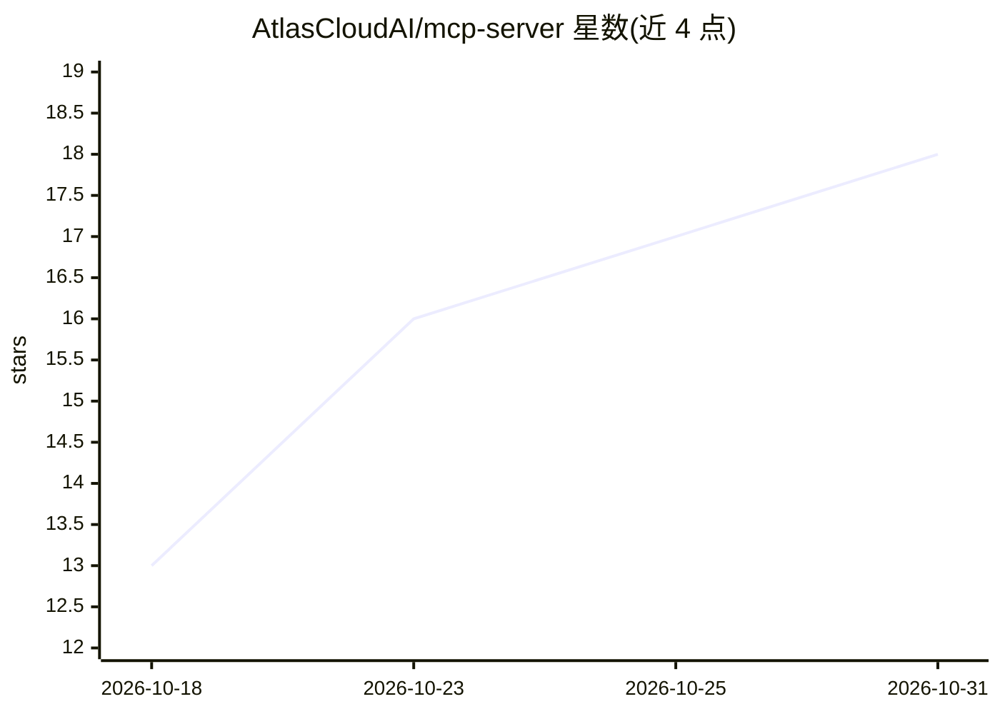

# AtlasCloudAI/mcp-server

⭐ 18 · TypeScript · 推送 2026-10-30 · [GitHub](https://github.com/AtlasCloudAI/mcp-server) · [官网](https://www.atlascloud.ai) · 组织维护 · 中文 README

**让 AI 编程助手通过 MCP 调用 Atlas Cloud 510+ 生成模型的服务器**

Atlas Cloud 官方维护的 MCP server，把其平台上 510+ 图像/视频/3D/LLM/音频模型以标准 MCP 工具形式暴露给 Claude Code、Codex、Cursor、Cline 等客户端。提供托管端点（OAuth 2.1 登录，无需 API key）与本地运行（Node.js >= 18，npx atlascloud-mcp，需 API key）两种方式。LLM 调用按模型声明协议自动路由（OpenAI chat/responses、Anthropic Messages、原生 Gemini），生成工具支持 dry_run 预检请求体、动态参数 schema 校验，另有媒体上传、生成历史与账单查询等 14 个工具。上传文件仅临时使用，不可作永久托管。

## 筛选速览

| 维度 | 判定 | 备注 |
|---|---|---|
| AI 角色 | `ai-ecosystem` | LLM/agent 周边工具 |
| 许可风险 | `none` | — |
| 部署形态 | `library` | 以包/库形式分发 |
| 模型依赖 | — | README 未给出锁定关系 |
| 硬件要求 | — | 无带数字的原话,不猜 |
| 安装摩擦 | `low` | 无编译、无系统依赖或容器化 |
| 成熟度 | — | 结构信号不足 |

## 能力要点

- 14 个 MCP 工具：图像/视频/3D/音频生成、ASR 转录、LLM 对话、余额与用量查询
- 托管端点 OAuth 2.1 登录无需 API key，或本地 npx 运行自带 key
- LLM 调用按模型协议自动路由（OpenAI/Anthropic/原生 Gemini）
- dry_run 标志可预览完整请求体，不提交不计费

## 适用场景

- 在 Claude Code / Cursor 里用自然语言生成图片、视频、3D 模型和语音
- 上传本地图片后让助手调用图像编辑或图生视频模型
- 开发时预检生成请求参数，避免无效调用消耗额度
- 通过对话查询账户余额、用量与历史生成记录

## 场景标签

`图像生成` `视频生成` `语音识别` `语音合成` · 领域:内容生成

## 证据(README 行号)

> L13:  Use Atlas Cloud's 300+ image / video / LLM models in Claude Code, Codex, Gemini CLI, Cursor, Cline and more. Gener
> L47: Under the hood: model discovery, dynamic per-model parameter schemas (validated before every request so invalid par
> L170: |`atlas_chat`|Chat with LLM models — endpoint and request format are picked automatically per model (OpenAI chat/r

## 星数曲线

2026-10-18 13 → 2026-10-31 18（+5）

---
*卡片 v1 · prompt 1.4 · 生成 2026-10-30 · 置信度 high · 依据 README sha `b4d05c331e03` · [字段定义](../../DATASET.md)*
