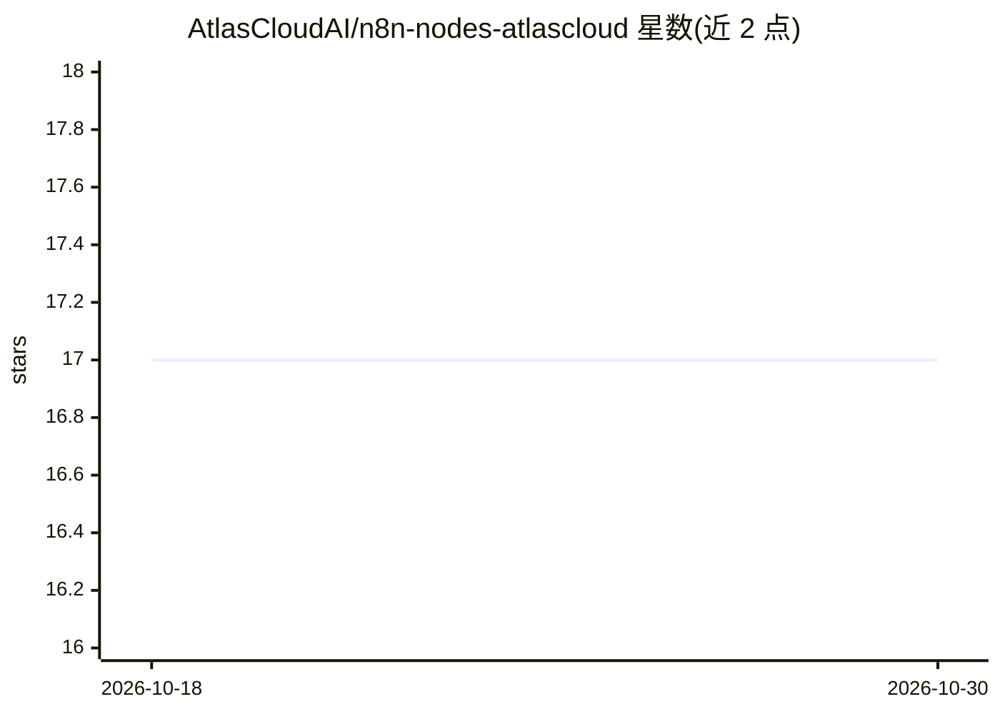

# AtlasCloudAI/n8n-nodes-atlascloud

⭐ 17 · TypeScript · MIT · 推送 2026-06-15 · [GitHub](https://github.com/AtlasCloudAI/n8n-nodes-atlascloud) · [官网](https://www.atlascloud.ai) · 组织维护

**n8n 社区节点包：在 n8n 工作流中调用 300+ AI 模型**

Atlas Cloud 发布的 n8n 社区节点包，通过一个 OpenAI 兼容 API 在 n8n 工作流内调用 300+ 图像、视频、LLM 与音频模型。提供三类节点：Chat 节点用于 LLM 对话；Task Submit 节点按所选模型动态渲染参数并支持仅提交/等待完成两种执行模式；Task Status 节点查询与轮询异步任务。需 Atlas Cloud API Key，经 n8n Community Nodes 安装 npm 包，附示例工作流 JSON。

## 筛选速览

| 维度 | 判定 | 备注 |
|---|---|---|
| AI 角色 | `ai-ecosystem` | LLM/agent 周边工具 |
| 许可风险 | `permissive` | MIT |
| 部署形态 | `None` |  |
| 模型依赖 | — | README 未给出锁定关系 |
| 硬件要求 | — | 无带数字的原话,不猜 |
| 安装摩擦 | `low` | 无编译、无系统依赖或容器化 |
| 成熟度 | — | 结构信号不足 |

## 能力要点

- 一个 API Key 接入 300+ 模型（OpenAI 兼容接口）
- 节点按所选模型 schema 动态渲染必填/可选参数
- 异步任务提交/状态轮询两种执行模式
- workflows/ 目录附可直接导入的示例工作流 JSON

## 适用场景

- 在 n8n 工作流中生成图像或视频并自动下载
- 搭建调用 Claude/GPT 等 LLM 的对话工作流
- 提交异步视频生成任务并轮询取回结果

## 场景标签

`工作流自动化` `图像生成` `视频生成` · 领域:效率与自动化

## 证据(README 行号)

> L8: > Use Atlas Cloud's 300+ AI models inside n8n workflows. Supports Sora 2 · Veo 3.1 · Kling 3 · Seedance 2 · Nano Ban
> L21: …and 300+ models in total, all via one API. The nodes below adapt automatically to each model's parameters.
> L55: 1. Open your n8n instance and go to **Settings** > **Community Nodes**.

## 星数曲线

2026-10-18 17 → 2026-10-30 17（+0）

---
*卡片 v1 · prompt 1.4 · 生成 2026-10-30 · 置信度 high · 依据 README sha `4ec1794c7cb3` · [字段定义](../../DATASET.md)*
