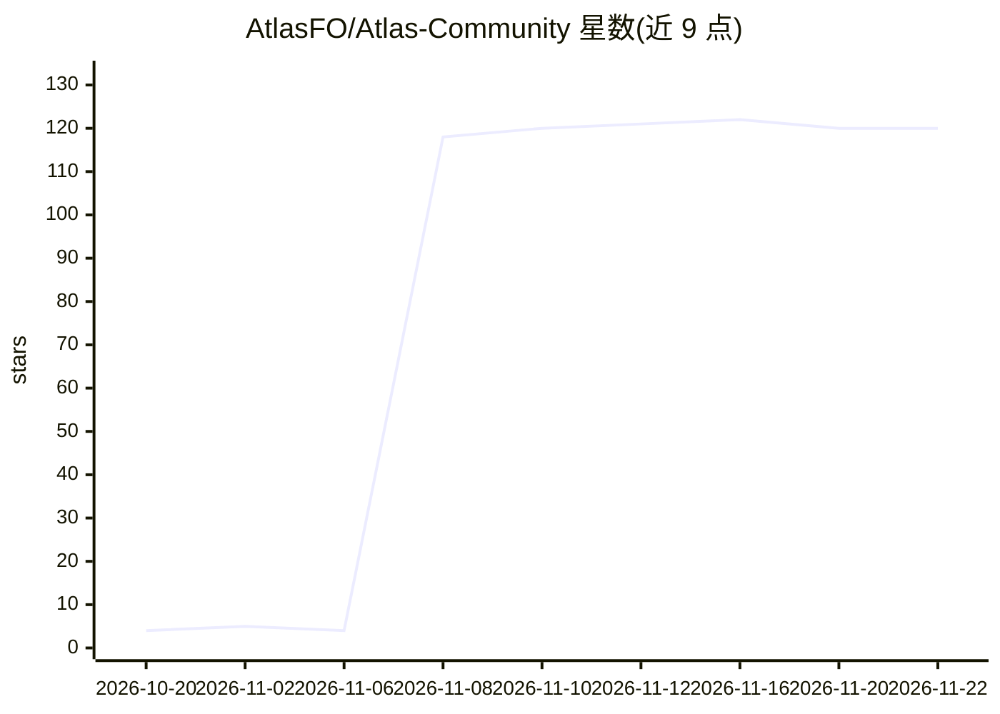

# AtlasFO/Atlas-Community

⭐ 120 · Python · NOASSERTION · 推送 2026-11-03 · [GitHub](https://github.com/AtlasFO/Atlas-Community) · [官网](https://www.dfir-systems.de) · 组织维护

**自主 DFIR 取证调查 agent：对磁盘/内存/日志跑完整调查**

面向数字取证与应急响应（DFIR）从业者的自主调查 agent：输入磁盘镜像、内存转储或日志导出，自动完成磁盘分诊、内存取证、Windows 工件解析、IOC 富化、YARA 狩猎与时间线构建，产出结构化报告与可点击的审计链路，每条结论可回溯到产生它的工具调用。由五个模型角色分工（分析师、阶段主管、对抗性审阅者、报告撰写者、运行评审者）。支持任意 OpenAI 兼容后端及 Anthropic、Ollama、vLLM 等；需 Python 3.11+、Ubuntu 24.04/Debian 12，安装脚本自动配置取证工具链；许可证为 PolyForm 非商业/免费试用双许可。

## 筛选速览

| 维度 | 判定 | 备注 |
|---|---|---|
| AI 角色 | `ai-native` | 本体是模型或模型工具 |
| 许可风险 | `none` | NOASSERTION |
| 部署形态 | `desktop` | 安装包/桌面程序 |
| 模型依赖 | local-ok | 支持本地模型 |
| 硬件要求 | — | 无带数字的原话,不猜 |
| 安装摩擦 | `low` | 无编译、无系统依赖或容器化 |
| 成熟度 | — | 结构信号不足 |

## 能力要点

- 端到端自主调查：分诊、分析、报告分阶段自动执行
- 五模型角色分工，含对抗性审阅者挑战每条结论
- 每条发现回溯到工具调用的审计链路
- 支持任意 OpenAI 兼容后端与 Anthropic 原生 API

## 适用场景

- 对磁盘镜像或内存转储跑自动取证调查并出报告
- 取证团队通过 Web 仪表盘跟踪调查过程与发现
- 用 YARA 规则对证据做威胁狩猎

## 场景标签

`网络安全` · 领域:学习与行业

## 证据(README 行号)

> L3:  An autonomous DFIR agent. Point it at the evidence and get back an investigation that shows its work.
> L20: Atlas is a Digital Forensics and Incident Response (DFIR) agent. Point it at disk images, memory dumps or log expor

## 星数曲线

2026-10-20 4 → 2026-11-22 120（+116）

---
*卡片 v1 · prompt 1.4 · 生成 2026-11-17 · 置信度 mid · 依据 README sha `ff6063f9a448` · [字段定义](../../DATASET.md)*
