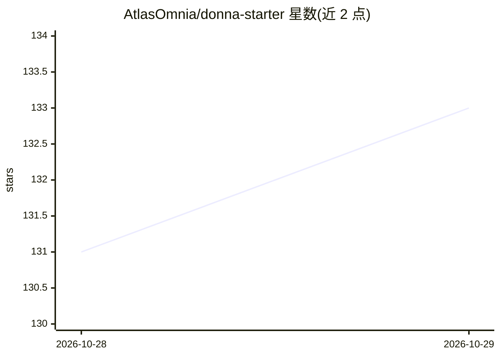

# AtlasOmnia/donna-starter

⭐ 133 · Python · MIT · 推送 2026-10-26 · [GitHub](https://github.com/AtlasOmnia/donna-starter) · [官网](https://hermesagenttools.com/) · 组织维护

**面向用户的开箱即用 Hermes Agent 预设档案（人设+72技能）**

Donna 是 Hermes Agent 的预配置 profile：包含一套固定人设（SOUL.md）、72 个策展技能（Hermes 配置、研究验证、GitHub 工作流、macOS 自动化、Reddit/X 社交等）、引导式首跑配置流程，以及默认关闭的 Token Router 插件（按轮收窄模型可见的工具面）。面向不想从零搭建助手的用户；需先安装 Hermes Agent，默认模型提供商为 DeepSeek，记忆默认使用本地 Mnemosyne。仓库本身即 profile，git clone 到 Hermes profiles 目录即完成安装。

## 筛选速览

| 维度 | 判定 | 备注 |
|---|---|---|
| AI 角色 | `ai-native` | 本体是模型或模型工具 |
| 许可风险 | `permissive` | MIT |
| 部署形态 | `None` |  |
| 模型依赖 | locked-api |  |
| 硬件要求 | — | 无带数字的原话,不猜 |
| 安装摩擦 | `low` | 无编译、无系统依赖或容器化 |
| 成熟度 | — | 结构信号不足 |

## 能力要点

- 72 个策展技能覆盖研究、GitHub、macOS 自动化、社交等类别
- 首跑引导逐项介绍工具集与集成，不静默启用任何功能
- 可选 Token Router 插件按需收窄每轮工具面（默认禁用，含可选分类器）
- 不含任何 API key 或个人记忆，克隆即用

## 适用场景

- 不想自己搭建 Hermes Agent profile 的用户开箱获得带人设的助手
- 通过引导流程按需启用搜索、记忆、Obsidian 等集成
- 用预置技能做研究、GitHub 工作流与 macOS 自动化任务

## 场景标签

`AI 助手` · 领域:对话与助手

## 证据(README 行号)

> L7: Donna is a pre-configured Hermes Agent
> L8: profile for people who want a capable, opinionated assistant without building one

## 星数曲线

2026-10-28 131 → 2026-10-29 133（+2）

---
*卡片 v1 · prompt 1.4 · 生成 2026-10-28 · 置信度 high · 依据 README sha `04fdb69135f4` · [字段定义](../../DATASET.md)*
