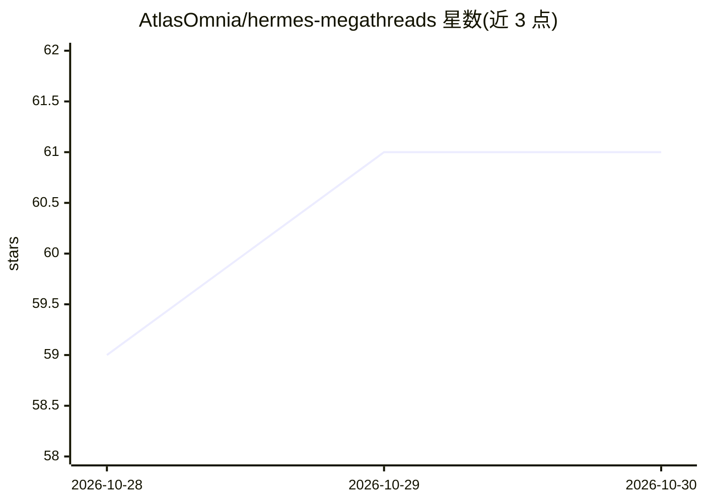

# AtlasOmnia/hermes-megathreads

⭐ 61 · 推送 2026-10-26 · [GitHub](https://github.com/AtlasOmnia/hermes-megathreads) · [官网](https://www.reddit.com/r/hermesagent/) · 组织维护

**Hermes Agent 社区维护的 Reddit 超级帖 Markdown 参考汇编**

将 r/hermesagent Reddit 超级帖转为可编辑的 Markdown 文档仓库，属 AtlasOmnia Hermes Agent 工具集的一部分。内容按板块组织：入门设置、信任边界、运行与架构（集成插件、看板、多 Agent、VPS 部署、成本优化）、模型与供应商（免费模型与 API、Mac MLX、Qwen 社区变体）、用例目录，各条目标注版本日期。更新通过 issue、在线编辑或 PR 提交，要求注明免费层、限额、OpenAI 兼容性与验证日期。

## 筛选速览

| 维度 | 判定 | 备注 |
|---|---|---|
| AI 角色 | `ai-knowledge` | 知识聚合/清单类 |
| 许可风险 | `none` | — |
| 部署形态 | `None` |  |
| 模型依赖 | — | README 未给出锁定关系 |
| 硬件要求 | — | 无带数字的原话,不猜 |
| 安装摩擦 | `low` | 无编译、无系统依赖或容器化 |
| 成熟度 | — | 结构信号不足 |

## 能力要点

- Reddit 超级帖的可编辑 Markdown 化
- 覆盖设置、部署、多 Agent、成本优化等板块的条目索引
- 条目标注发布/复核日期，区分历史快照
- 规定了模型/API 条目的更新字段要求

## 适用场景

- 查找 Hermes Agent 从零开始的设置与部署指引
- 查找模型、供应商与免费 API 的社区整理信息
- 通过 PR/issue 修正或补充条目

## 场景标签

`精选清单` · 领域:学习与行业

## 证据(README 行号)

> L5: Community-maintained Markdown versions of r/hermesagent megathreads.
> L13: - How to Set Up Hermes Agent from Scratch — July 2026

## 星数曲线

2026-10-28 59 → 2026-10-30 61（+2）

---
*卡片 v1 · prompt 1.4 · 生成 2026-10-28 · 置信度 high · 依据 README sha `0d13eef3a72d` · [字段定义](../../DATASET.md)*
