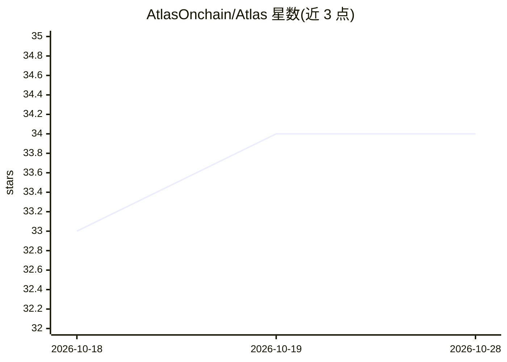

# AtlasOnchain/Atlas

⭐ 34 · TypeScript · 推送 2026-06-22 · [GitHub](https://github.com/AtlasOnchain/Atlas) · 组织维护

**Solana 链上资金流追踪器：定位先手钱包与跟风传播**

TypeScript 编写的 Solana 链上资金流分析工具：维护一组受关注钱包，通过 Helius API 拉取近期链上活动，从代币流动推断板块暴露，按滞后与规模相似度计算传播评分，区分先行者与第二波跟风，并在图仍处于早期时调用 Claude agent 生成资金流警报。传播评分由公式（滞后调整跟风率×规模相似度×板块重叠）计算，AI 用于警报生成与解释环节。需配置 Anthropic 与 Helius API key，用 Bun 运行。

## 筛选速览

| 维度 | 判定 | 备注 |
|---|---|---|
| AI 角色 | `ai-enhanced` | 去掉 AI 部分产品仍成立 |
| 许可风险 | `none` | — |
| 部署形态 | `None` |  |
| 模型依赖 | locked-api |  |
| 硬件要求 | — | 无带数字的原话,不猜 |
| 安装摩擦 | `low` | 无编译、无系统依赖或容器化 |
| 成熟度 | — | 结构信号不足 |

## 能力要点

- 追踪源钱包、跟风传播与板块轮动
- 传播评分：滞后调整跟风率×规模相似度×板块重叠
- 跟风饱和度与滞后窗口等风险控制过滤
- 调用 Claude agent 生成资金流警报

## 适用场景

- 追踪 Solana 巨鲸与 VC 钱包的先手动向
- 判断一笔链上资金流是引领还是拥挤的跟风
- 按板块（meme/infra/staking 等）观察资金轮动

## 场景标签

`数据分析` · 领域:效率与自动化

## 证据(README 行号)

> L13: `Atlas` tracks a curated wallet set, fetches recent Helius activity, infers sector exposure from token movement, an
> L8: Built with Claude Agent SDK

## 星数曲线

2026-10-18 33 → 2026-10-28 34（+1）

---
*卡片 v1 · prompt 1.4 · 生成 2026-10-25 · 置信度 mid · 依据 README sha `a24ed2252583` · [字段定义](../../DATASET.md)*
