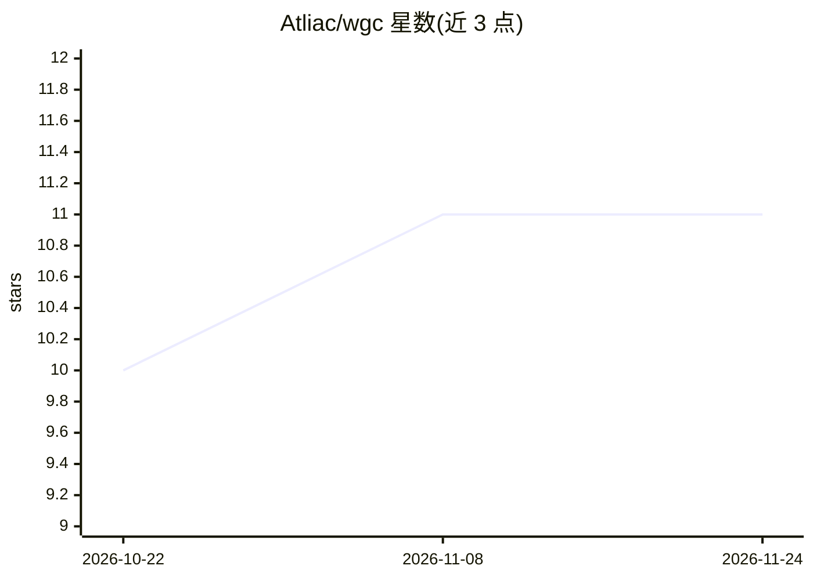

# Atliac/wgc

⭐ 11 · Rust · Apache-2.0 · 推送 2026-11-03 · [GitHub](https://github.com/Atliac/wgc) · 个人维护

**面向 ML/CV 流程的 Windows 屏幕捕获 Rust 封装库**

对 Windows.Graphics.Capture API 的 Rust 封装，支持在 Windows 10/11 上捕获全屏、指定窗口或经系统选择器交互选定的目标。帧流遵循标准 Rust 迭代器语义并自动管理资源；针对机器学习输入提供硬件加速的字幕盒（letterboxing）与缩放以生成统一张量输入，另支持脏区域跟踪、分辨率/DPI 自适应、光标与边框显示控制及 RGBA/BGRA 像素格式配置。通过 crates.io 分发，仓库内含 4 个可运行示例。

## 筛选速览

| 维度 | 判定 | 备注 |
|---|---|---|
| AI 角色 | `ai-enhanced` | 去掉 AI 部分产品仍成立 |
| 许可风险 | `permissive` | Apache-2.0 |
| 部署形态 | `library` | 以包/库形式分发 |
| 模型依赖 | — | README 未给出锁定关系 |
| 硬件要求 | — | 无带数字的原话,不猜 |
| 安装摩擦 | `low` | 无编译、无系统依赖或容器化 |
| 成熟度 | — | 结构信号不足 |

## 能力要点

- 基于 Direct3D 11 与 DWM 的硬件加速屏幕/窗口捕获
- 面向 ML 张量输入的实时 letterbox 与缩放，无失真
- 脏区域跟踪与帧间变化子矩形提取
- 窗口缩放/跨屏/DPI 变化时自动重建内部帧缓冲

## 适用场景

- 为机器学习/计算机视觉流程采集统一格式的屏幕帧
- 监控特定应用窗口的实时画面
- 仅处理帧间变化像素以降低重处理开销

## 场景标签

 · 领域:系统工具/图形捕获

## 证据(README 行号)

> L10: A simple and ergonomic Rust wrapper for Windows.Graphics.Capture API, enabling screen/window capture on Windows 10/
> L12: **Realtime & AI-optimized** capture for ML and computer vision workflows.
> L19: - **AI & Computer Vision Ready**: Real-time hardware letterboxing and scaling for uniform machine learning tensor i

## 星数曲线

2026-10-22 10 → 2026-11-24 11（+1）

---
*卡片 v1 · prompt 1.4 · 生成 2026-11-19 · 置信度 high · 依据 README sha `831cbe3c1d0d` · [字段定义](../../DATASET.md)*
