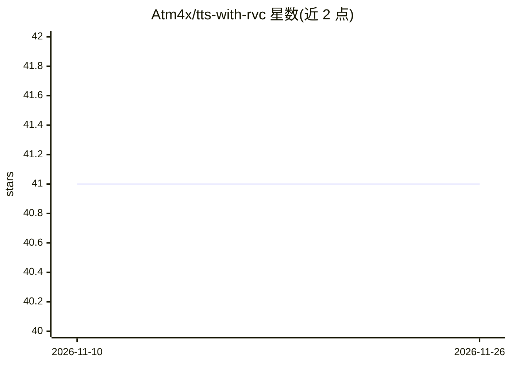

# Atm4x/tts-with-rvc

⭐ 41 · Python · MIT · 推送 2026-10-10 · [GitHub](https://github.com/Atm4x/tts-with-rvc) · [官网](https://pypi.org/project/tts-with-rvc/) · 个人维护

**Python 包：文本转语音后用 RVC 模型替换语音音色**

TTS-with-RVC 是一个 Python 包，将 Edge-TTS 文本转语音与 RVC 语音转换模块串联：先由 TTS 模块把文本生成为临时音频，再由 RVC 模块读取该音频并输出替换音色后的 .wav 文件。用户需自备 .pth 声音模型（可配 index 文件），可调音高、语速、音量、F0 提取方法等参数。要求 Python≤3.12 与 PyTorch（CUDA 或 MPS），ffmpeg 为必需组件；提供 process_args 解析文本内嵌参数以便接入其他模块（如 GPT）。作者声明可能含 bug，MPS 未测试。

## 筛选速览

| 维度 | 判定 | 备注 |
|---|---|---|
| AI 角色 | `ai-native` | 本体是模型或模型工具 |
| 许可风险 | `permissive` | MIT |
| 部署形态 | `library` | 以包/库形式分发 |
| 模型依赖 | — | README 未给出锁定关系 |
| 硬件要求 | — | 无带数字的原话,不猜 |
| 安装摩擦 | `medium` | 含编译或系统依赖之一 |
| 成熟度 | `idea` | |

## 能力要点

- TTS 生成后经 RVC 模块替换音色，输出 .wav 文件
- 支持 pitch、index_rate、f0_method（rmvpe/fcpe/pm/harvest/dio/crepe）等参数
- process_args 解析 --tts-rate 等内嵌文本参数，便于与 GPT 等模块集成
- voiceover_file 可直接对已有文件做语音替换（不经过 TTS）

## 适用场景

- 给 TTS 输出套用自定义声音模型生成配音音频
- 聊天机器人/虚拟主播场景中把文本转为指定音色语音
- 对已有音频文件直接做 RVC 音色替换

## 场景标签

`语音合成` · 领域:内容生成

## 证据(README 行号)

> L3: ***TTS-with-RVC** (Text-to-Speech with RVC)* is a package designed to enhance the capabilities of *text-to-speech (T
> L27: 1. **Text-to-Speech (TTS):** Users enter text into the TTS module, which then processes it and generates the corres
> L28: 2. **RVC:** With .pth file provided, RVC module reads the generated audio file, processes it and generates an new a

## 星数曲线

2026-11-10 41 → 2026-11-26 41（+0）

---
*卡片 v1 · prompt 1.4 · 生成 2026-11-18 · 置信度 high · 依据 README sha `23bee18cd3fc` · [字段定义](../../DATASET.md)*
