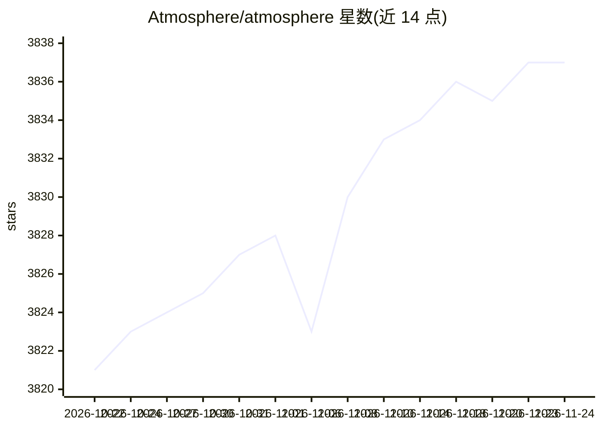

# Atmosphere/atmosphere

⭐ 3,837 · Java · Apache-2.0 · 推送 2026-11-24 · [GitHub](https://github.com/Atmosphere/atmosphere) · [官网](https://async-io.live) · 组织维护

**JVM 上的 AI Agent 实时运行框架：一个 @Agent 跨多种 AI 框架运行**

面向 JVM 团队的实时事件驱动 Agent 框架（自述非托管平台）：以 @Agent 注解声明深度 Agent（默认含记忆、计划工具、虚拟文件系统、子 Agent 委派），通过 AgentRuntime SPI 提供内建 OpenAI 兼容适配器及 Spring AI、LangChain4j、Anthropic、Cohere 等 12 个适配器。令牌流经可过滤、门控与观察的广播器，支持 WebSocket、SSE、long-polling、gRPC（WebTransport/HTTP3 可选），对外暴露 MCP、A2A、AG-UI 及 Slack/Telegram 等通道，并含策略准入、HITL 审批、成本上限、PII 改写与血缘记录等治理能力。宿主容器由用户选择（Tomcat、Spring Boot、Quarkus 等），计算与调度不在框架范围内。

## 筛选速览

| 维度 | 判定 | 备注 |
|---|---|---|
| AI 角色 | `ai-ecosystem` | LLM/agent 周边工具 |
| 许可风险 | `permissive` | Apache-2.0 |
| 部署形态 | `library` | 以包/库形式分发 |
| 模型依赖 | local-ok | 支持本地模型 |
| 硬件要求 | — | 无带数字的原话,不猜 |
| 安装摩擦 | `medium` | 含编译或系统依赖之一 |
| 成熟度 | — | 结构信号不足 |

## 能力要点

- 一个 @Agent 类通过 12 个运行时适配器（含合同测试锁定能力矩阵）跨框架运行
- WebSocket/SSE/long-polling/gRPC 默认实时传输，WebTransport/HTTP3 可选
- 治理能力：策略准入、持久化 HITL 审批、成本上限、PII 改写、管理员终止开关
- 对外暴露 MCP、A2A、AG-UI 协议及 Slack/Telegram/Discord/WhatsApp/Messenger 通道

## 适用场景

- 在现有 Spring Boot/Quarkus 等 JVM 技术栈中接入有状态流式 Agent
- 构建需要人工审批与治理的多通道（网页/Slack/Telegram 等）Agent 服务
- 同一 Agent 代码在不同 AI 框架适配器之间切换运行
- 需要会话恢复、重放与血缘审计的长时 Agent 运行

## 场景标签

`Agent 框架` · 领域:Agent 开发

## 证据(README 行号)

> L5:  The real-time engine for AI agents on the JVM. Tokens flow from the LLM runtime to the client through a broadcaster
> L35: |Runtime dispatch|`atmosphere-ai` `AgentRuntime` SPI + 12 adapters with contract-tested capability flags|Model host
> L123: |Runtime adapter|The Atmosphere integration that implements `AgentRuntime`|Built-in, Spring AI, LangChain4j, Googl

## 星数曲线

2026-10-22 3,821 → 2026-11-24 3,837（+16）

---
*卡片 v1 · prompt 1.4 · 生成 2026-11-24 · 置信度 mid · 依据 README sha `44ace9cb460b` · [字段定义](../../DATASET.md)*
