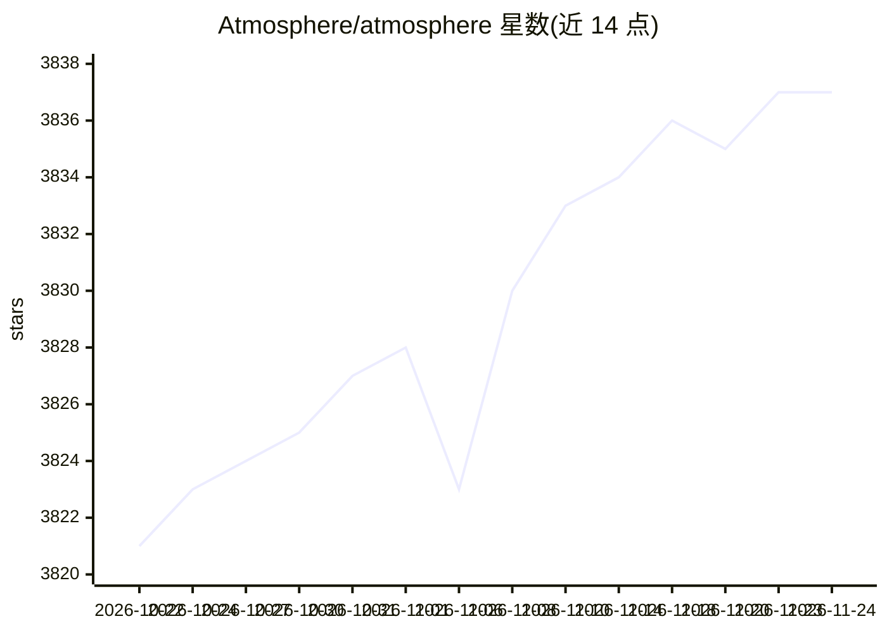

# Atmosphere/atmosphere

⭐ 3,837 · Java · Apache-2.0 · 推送 2026-11-22 · [GitHub](https://github.com/Atmosphere/atmosphere) · [官网](https://async-io.live) · 组织维护

**JVM 上 AI Agent 的实时运行时框架：一套 @Agent 接多种运行时**

面向 JVM 的实时事件驱动 Agent 框架，定位为运行时原语而非托管平台，宿主（Tomcat/Quarkus/Spring Boot 等）负责计算与调度。一个 @Agent 注解声明 agent，通过 AgentRuntime SPI 接 12 个运行时适配器（Spring AI、LangChain4j、Anthropic、Cohere、Google ADK 等），经 WebSocket/SSE/gRPC 流式输出，并暴露 MCP、A2A、AG-UI 端点。内置记忆、计划、虚拟文件系统、子 agent 委派的 harness，提供策略准入、HITL 审批、成本上限、PII 改写与 lineage 观测。安装走 brew/curl CLI 或 Maven/npm。

## 筛选速览

| 维度 | 判定 | 备注 |
|---|---|---|
| AI 角色 | `ai-ecosystem` | LLM/agent 周边工具 |
| 许可风险 | `permissive` | Apache-2.0 |
| 部署形态 | `library` | 以包/库形式分发 |
| 模型依赖 | local-ok | 支持本地模型 |
| 硬件要求 | — | 无带数字的原话,不猜 |
| 安装摩擦 | `medium` | 含编译或系统依赖之一 |
| 成熟度 | — | 结构信号不足 |

## 能力要点

- AgentRuntime SPI 带 12 个可互换运行时适配器，能力由契约测试固定
- WebSocket/SSE/long-polling/gRPC 统一广播管道，可选 WebTransport/HTTP-3
- MCP、A2A、AG-UI 端点与 Slack/Telegram/Discord 等频道适配器
- 治理机制：策略准入、持久化 HITL 审批、成本上限、PII 改写、admin kill switch

## 适用场景

- 在既有 JVM/Spring 技术栈里运行带治理与人工审批的 agent
- 同一 agent 代码在多个 AI 框架适配器间切换而无需改端点
- 把 agent 通过 MCP/A2A/AG-UI 暴露给多客户端与消息渠道
- 需要重连、断点恢复与回放的长时 agent 会话

## 场景标签

`Agent 框架` · 领域:Agent 开发

## 证据(README 行号)

> L5:  The real-time engine for AI agents on the JVM. Tokens flow from the LLM runtime to the client through a broadcaster
> L20: |Swap AI integrations|One `AgentRuntime` SPI with twelve runtime adapters and contract-tested capability flags|
> L130: `atmosphere-ai` ships the `AgentRuntime` SPI plus the Built-in OpenAI-compatible adapter. Eleven additional adapte

## 星数曲线

2026-10-22 3,821 → 2026-11-24 3,837（+16）

---
*卡片 v1 · prompt 1.4 · 生成 2026-11-23 · 置信度 high · 依据 README sha `c905ffed2920` · [字段定义](../../DATASET.md)*
