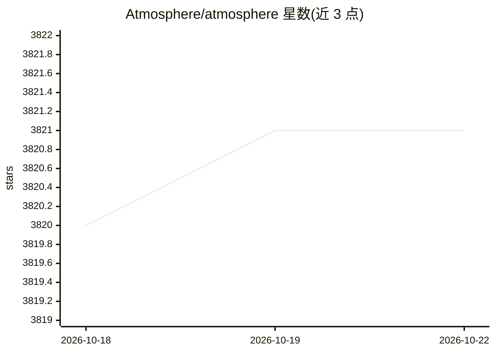

# Atmosphere/atmosphere

⭐ 3,821 · Java · Apache-2.0 · 推送 2026-10-22 · [GitHub](https://github.com/Atmosphere/atmosphere) · [官网](https://async-io.live) · 组织维护

**JVM 上的 AI agent 实时运行时框架：一个 @Agent 跨 12 个运行时适配器运行**

面向 JVM 团队的 AI agent 框架：通过 AgentRuntime SPI 提供 12 个运行时适配器（内置 OpenAI 兼容、Spring AI、LangChain4j、Google ADK、Anthropic、Cohere 等），同一个 @Agent 类可切换适配器运行。提供 WebSocket/SSE/gRPC/WebTransport 流式传输、治理（策略准入、人工审批、成本上限、PII 重写）、持久会话与重放、MCP/A2A/AG-UI 协议端点及 Slack/Telegram 等渠道模块。定位为框架而非托管平台，不托管模型权重，宿主容器负责计算调度。通过 brew/curl 安装 CLI，Maven Central 发布。

## 筛选速览

| 维度 | 判定 | 备注 |
|---|---|---|
| AI 角色 | `ai-ecosystem` | LLM/agent 周边工具 |
| 许可风险 | `permissive` | Apache-2.0 |
| 部署形态 | `library` | 以包/库形式分发 |
| 模型依赖 | local-ok | 支持本地模型 |
| 硬件要求 | — | 无带数字的原话,不猜 |
| 安装摩擦 | `medium` | 含编译或系统依赖之一 |
| 成熟度 | — | 结构信号不足 |

## 能力要点

- AgentRuntime SPI + 12 个运行时适配器，同一 @Agent 代码切换调度后端
- WebSocket/SSE/长轮询/gRPC/可选 WebTransport(HTTP/3) 单一广播管道
- 治理链路：策略准入、人工审批、成本上限、PII 重写、管理端终止开关
- 内置深度 agent 能力：记忆、write_todos 计划、虚拟文件系统、子 agent 委派

## 适用场景

- 在现有 Spring Boot/JVM 栈中构建有治理的人工在环 agent 服务
- 让同一 agent 代码跨 Spring AI、LangChain4j、Anthropic 等运行时移植
- 通过 MCP/A2A/AG-UI 及 Slack/Telegram 等渠道对外暴露 agent

## 场景标签

`Agent 框架` · 领域:Agent 开发

## 证据(README 行号)

> L20: |Swap AI integrations|One `AgentRuntime` SPI with twelve runtime adapters and contract-tested capability flags|
> L35: |Runtime dispatch|`atmosphere-ai` `AgentRuntime` SPI + 12 adapters with contract-tested capability flags|Model host

## 星数曲线

2026-10-18 3,820 → 2026-10-22 3,821（+1）

---
*卡片 v1 · prompt 1.4 · 生成 2026-10-21 · 置信度 mid · 依据 README sha `4a44c82760c7` · [字段定义](../../DATASET.md)*
