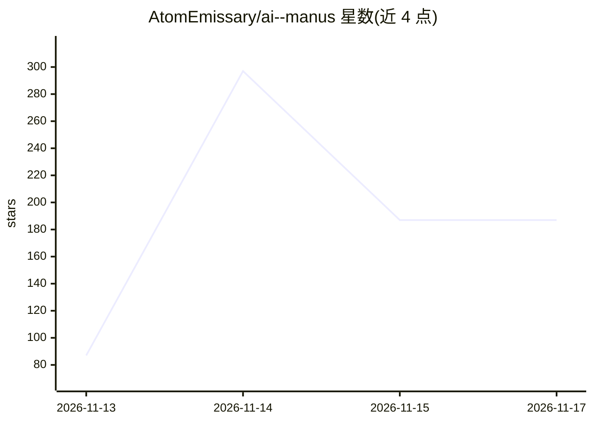

# AtomEmissary/ai--manus

⭐ 187 · Apache-2.0 · 推送 2026-11-15 · [GitHub](https://github.com/AtomEmissary/ai--manus) · 个人维护

**自主 AI Agent：代用户执行代码与控制浏览器完成多步任务**

面向家庭、学习与轻量办公场景的自主 AI Agent，用户用自然语言下达指令，Agent 自行规划并执行：编写和运行脚本、打开网页、填写表单、跨脚本与浏览器的多步骤任务，可在后台待命并跨会话重复执行同类工作流。README 未给出具体安装命令或代码入口，仅描述准备、配置、测试等使用步骤，并给出最低 4GB 内存、双核 CPU 的兼容性表格。面向无需编程背景的普通用户。

## 筛选速览

| 维度 | 判定 | 备注 |
|---|---|---|
| AI 角色 | `ai-native` | 本体是模型或模型工具 |
| 许可风险 | `permissive` | Apache-2.0 |
| 部署形态 | `None` |  |
| 模型依赖 | — | README 未给出锁定关系 |
| 硬件要求 | — | 无带数字的原话,不猜 |
| 安装摩擦 | `low` | 无编译、无系统依赖或容器化 |
| 成熟度 | — | 结构信号不足 |

## 能力要点

- 自主执行代码与脚本运行
- 浏览器控制：导航网页、填表、采集信息
- 脚本与浏览器动作可在同一工作流中衔接
- 面向家庭/学习/轻量办公的小规模任务设计

## 适用场景

- 让 Agent 代为完成网页信息采集与表单填写
- 自动运行小脚本与文件整理等重复性事务
- 学习研究中收集资料、整理笔记

## 场景标签

`浏览器自动化` `编码 Agent` `工作流自动化` · 领域:效率与自动化

## 证据(README 行号)

> L10: - **Autonomous Code Execution:** Manus AI agent runs code on its own to complete tasks, so you can focus on decisio
> L18: Manus is an autonomous AI agent designed to run code and control a browser on your behalf. Instead of acting like a
> L22: Manus is not a heavy studio suite or a complex enterprise platform. It is a focused helper built for home, study, a

## 星数曲线

2026-11-13 87 → 2026-11-17 187（+100）

---
*卡片 v1 · prompt 1.4 · 生成 2026-11-17 · 置信度 mid · 依据 README sha `0f78ee3a5dd2` · [字段定义](../../DATASET.md)*
