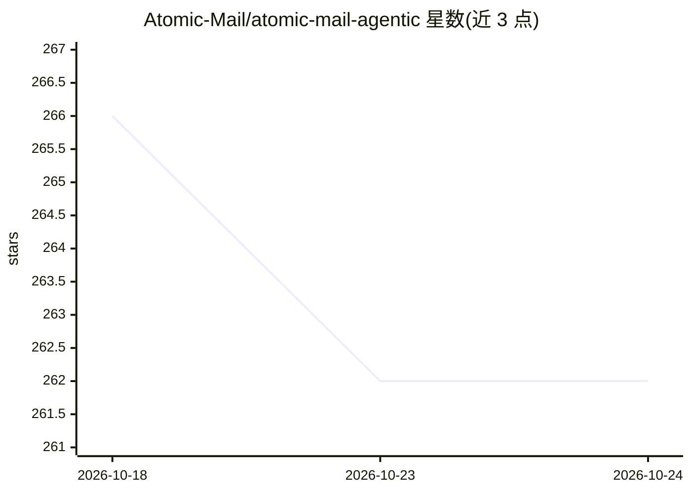

# Atomic-Mail/atomic-mail-agentic

⭐ 264 · TypeScript · MIT · 推送 2026-10-23 · [GitHub](https://github.com/Atomic-Mail/atomic-mail-agentic) · [官网](https://atomicmail.ai) · 组织维护

**给自主 AI 代理提供独立邮箱的客户端集成与服务**

Atomic Mail 提供面向自主 AI 代理的邮箱服务：代理自行注册 @atomicmail.ai 收件箱并全程管理，基于 JMAP（RFC 8620/8621）暴露完整邮箱 API（收发、草稿、线程、搜索），注册采用 proof-of-work 反滥用协议，无需 CAPTCHA 或人工审核。本仓库交付客户端集成：MCP、shell CLI、ClawHub、Dify 插件等，暴露 register、jmap_request、help 三个工具，用于封装 PoW 协议复杂度。支持自定义域名（需人工在 dashboard 配置 DNS）。账号免费，配额 100 MB。

## 筛选速览

| 维度 | 判定 | 备注 |
|---|---|---|
| AI 角色 | `ai-ecosystem` | LLM/agent 周边工具 |
| 许可风险 | `permissive` | MIT |
| 部署形态 | `library` | 以包/库形式分发 |
| 模型依赖 | — | README 未给出锁定关系 |
| 硬件要求 | — | 无带数字的原话,不猜 |
| 安装摩擦 | `low` | 无编译、无系统依赖或容器化 |
| 成熟度 | — | 结构信号不足 |

## 能力要点

- 基于 JMAP（RFC 8620/8621）的完整邮箱 API，无厂商 SDK 依赖
- proof-of-work 注册协议，代理免人工验证自行开通邮箱
- 提供 MCP、shell CLI、ClawHub、Dify 插件等多种集成路径
- 内置 send_mail、list_inbox、reply 等 JSON preset 与嵌入式 help 文档

## 适用场景

- 让代理订阅新闻通讯并自动整理发送摘要
- 代理接管支持邮箱，自动读取回复工单并按需升级
- 通过邮件开展异步用户调研并汇总结果

## 场景标签

 · 领域:AI 代理基础设施/邮件服务

## 证据(README 行号)

> L25: **Atomic Mail Agentic** is an email provider for autonomous AI agents, built by Atomic Mail. Agents register their 
> L33: This repository ships the client integrations: MCP, shell CLI, ClawHub, Dify plugin and more, exposing those APIs t

## 星数曲线

2026-10-18 266 → 2026-10-24 262（-4）

---
*卡片 v1 · prompt 1.4 · 生成 2026-10-22 · 置信度 high · 依据 README sha `41307b65d56c` · [字段定义](../../DATASET.md)*
