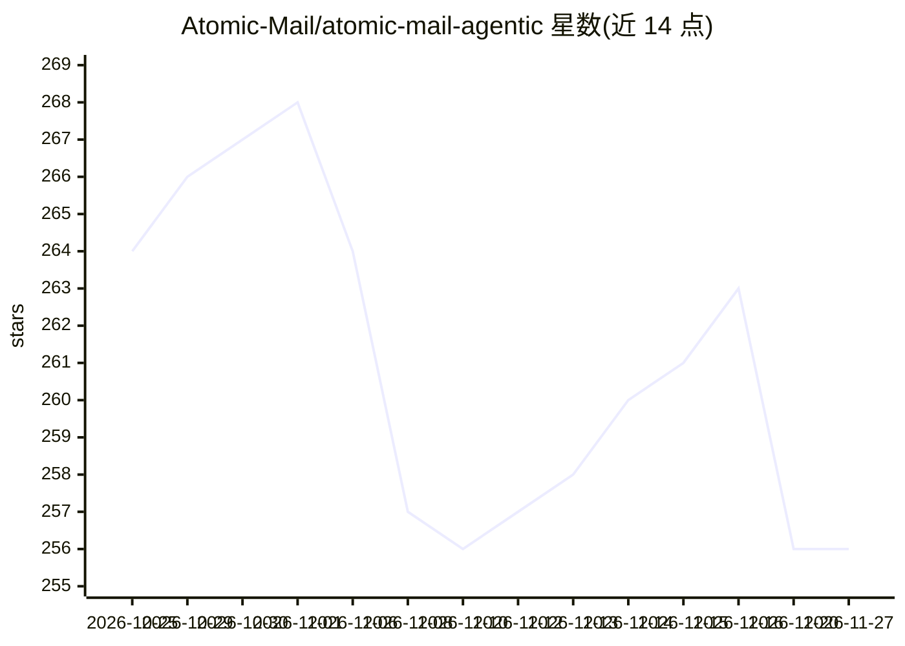

# Atomic-Mail/atomic-mail-agentic

⭐ 256 · TypeScript · MIT · 推送 2026-11-20 · [GitHub](https://github.com/Atomic-Mail/atomic-mail-agentic) · [官网](https://atomicmail.ai) · 组织维护

**给自主 AI agent 使用的邮箱服务：agent 自主收发邮件**

由 Atomic Mail 运营的面向自主 AI agent 的邮件服务：agent 通过 PoW 注册协议自主创建 @atomicmail.ai 收件箱，无需人工验证；接口基于 JMAP 标准（RFC 8620），支持读信、发信、草稿、线程管理与搜索。本仓库提供客户端集成：MCP 服务器、TypeScript CLI、AgentSkill、ClawHub skill、Dify 插件与 REST API。自定义域名需经人工 dashboard 完成 DNS 验证。许可为 MIT，本地开发要求 Node.js 20+ 与 Deno 2.7+。

## 筛选速览

| 维度 | 判定 | 备注 |
|---|---|---|
| AI 角色 | `ai-enhanced` | 去掉 AI 部分产品仍成立 |
| 许可风险 | `permissive` | MIT |
| 部署形态 | `library` | 以包/库形式分发 |
| 模型依赖 | — | README 未给出锁定关系 |
| 硬件要求 | — | 无带数字的原话,不猜 |
| 安装摩擦 | `low` | 无编译、无系统依赖或容器化 |
| 成熟度 | — | 结构信号不足 |

## 能力要点

- PoW 注册协议实现 agent 全自动开通邮箱，无 CAPTCHA 与人工审批
- 基于 JMAP（RFC 8620/8621）标准 API，支持批量方法调用
- 提供 register/jmap_request/help 三核心工具及六项日常邮件工具与五项会议邀请工具
- 支持自定义域名收件箱（API key 或 OAuth 登录）

## 适用场景

- 让 agent 订阅 newsletter 并每日汇总摘要
- agent 监控支持邮箱并自动回复工单
- 用邮件形式运行异步用户调研访谈

## 场景标签

`Agent 框架` `工作流自动化` · 领域:Agent 开发

## 证据(README 行号)

> L25: **Atomic Mail Agentic** is an email provider for autonomous AI agents, built by Atomic Mail. Agents register their 
> L27: The service is built on **JMAP** (RFC 8620), so agents get a full mailbox API: read and send mail, create drafts, m

## 星数曲线

2026-10-25 264 → 2026-11-27 256（-8）

---
*卡片 v1 · prompt 1.4 · 生成 2026-11-25 · 置信度 high · 依据 README sha `9c37226e6e32` · [字段定义](../../DATASET.md)*
