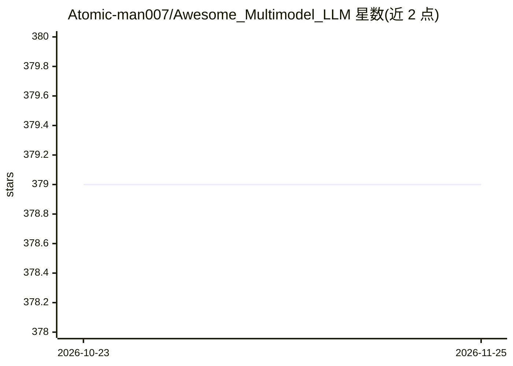

# Atomic-man007/Awesome_Multimodel_LLM

⭐ 379 · 推送 2026-11-08 · [GitHub](https://github.com/Atomic-man007/Awesome_Multimodel_LLM) · 个人维护

**多模态大语言模型资源策展清单，供研究者追踪进展**

以 GitHub 清单形式收录多模态大语言模型相关资源，按多模态指令微调、多模态上下文学习、视觉推理、记忆能力、长序列处理等类别组织论文条目，每条附论文、代码、数据集与演示链接；另含 LLM 学习思维导图、趋势项目列表与提示工程指南。声明将持续更新，并在撰写 LLM 与 MLLM 综述论文。本身不提供可运行软件，仅作资源索引。

## 筛选速览

| 维度 | 判定 | 备注 |
|---|---|---|
| AI 角色 | `ai-knowledge` | 知识聚合/清单类 |
| 许可风险 | `none` | — |
| 部署形态 | `None` |  |
| 模型依赖 | — | README 未给出锁定关系 |
| 硬件要求 | — | 无带数字的原话,不猜 |
| 安装摩擦 | `low` | 无编译、无系统依赖或容器化 |
| 成熟度 | — | 结构信号不足 |

## 能力要点

- 按指令微调、上下文学习、记忆机制、视觉推理等类别组织论文条目
- 条目附论文、代码、数据集、Demo 链接
- 含 LLM 学习思维导图与趋势项目列表
- 声明持续更新并撰写相关综述论文

## 适用场景

- 查找多模态指令微调方向的相关论文与代码
- 为 MLLM 研究选题梳理已有工作
- 追踪大语言模型领域最新进展

## 场景标签

`精选清单` · 领域:学习与行业

## 证据(README 行号)

> L1: # Awesome-Multimodal-LLM
> L5: ✨✨✨ Behold our meticulously curated trove of Multimodal Large Language Models (MLLM) resources! 📚🔍 Feast your eyes o
> L106: ## Multimodal Instruction Tuning

## 星数曲线

2026-10-23 379 → 2026-11-25 379（+0）

---
*卡片 v1 · prompt 1.4 · 生成 2026-11-25 · 置信度 high · 依据 README sha `296b27c0b01b` · [字段定义](../../DATASET.md)*
