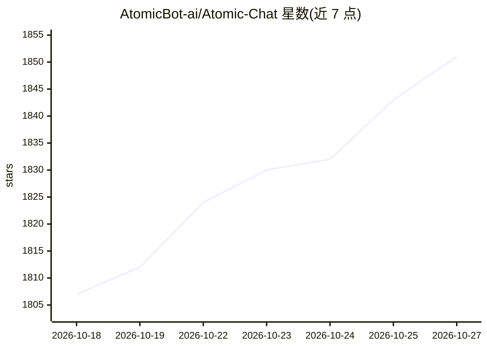

# AtomicBot-ai/Atomic-Chat

⭐ 1,851 · TypeScript · NOASSERTION · 推送 2026-10-26 · [GitHub](https://github.com/AtomicBot-ai/Atomic-Chat) · [官网](https://atomic.chat) · 组织维护

**本地运行开源大模型的桌面/移动聊天应用与推理引擎**

基于 Tauri 与 Node.js 的本地 AI 应用：从 HuggingFace 下载并本地运行 Llama、Gemma、Qwen、Mistral、Phi 等开源权重模型，提供对话、助手、项目、Artifacts 预览与 MCP 工具连接。内置三个推理引擎（atomic-llama-cpp-turboquant 分叉、上游 llama.cpp、MLX-VLM），支持 MTP/DFlash 投机解码、TurboQuant KV 缓存与 Flash Attention，并在 localhost:1337 暴露 OpenAI 兼容 API，供任意 agent/CLI/IDE 插件作为本地推理后端调用；也可切换到云端厂商（自带 key）。提供 macOS/Windows/Linux 桌面安装包与 iOS/Android 应用，默认仅绑定回环地址。系 Jan 的分叉，Apache 2.0 许可。

## 筛选速览

| 维度 | 判定 | 备注 |
|---|---|---|
| AI 角色 | `ai-native` | 本体是模型或模型工具 |
| 许可风险 | `none` | NOASSERTION |
| 部署形态 | `desktop` | 安装包/桌面程序 |
| 模型依赖 | local-ok | 支持本地模型 |
| 硬件要求 | — | 无带数字的原话,不猜 |
| 安装摩擦 | `high` | 编译与系统依赖俱全 |
| 成熟度 | — | 结构信号不足 |

## 能力要点

- 本地运行开源权重模型，三个推理引擎（llama.cpp 分叉/上游 llama.cpp/MLX-VLM）可切换
- OpenAI 兼容本地 API（localhost:1337/v1），任意 OpenAI SDK 客户端可直接接入
- MTP/DFlash 投机解码、TurboQuant KV 缓存、Flash Attention 开关
- 一键启动 OpenCode、Goose、Kilo Code 等 agent，并可连接多个 MCP 服务器

## 适用场景

- 在电脑上离线与本地大模型对话，数据不出机器
- 给 Claude Code、OpenCode 等编程 agent 提供本地 OpenAI 兼容推理后端
- 本地与云端模型（自带 key）在同一个应用内混用切换

## 场景标签

`聊天机器人` `推理引擎` · 领域:对话与助手

## 证据(README 行号)

> L5: Local AI app and inference engine for agents. Run open-weight LLMs locally — private, on your machine.
> L33: Atomic Chat runs an **OpenAI-compatible server at `http://localhost:1337/v1`** — a drop-in replacement for the Open

## 星数曲线

2026-10-18 1,807 → 2026-10-27 1,851（+44）

---
*卡片 v1 · prompt 1.4 · 生成 2026-10-21 · 置信度 high · 依据 README sha `78cb62500fd9` · [字段定义](../../DATASET.md)*
