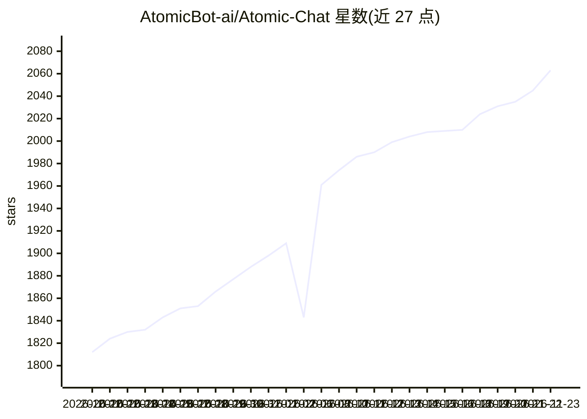

# AtomicBot-ai/Atomic-Chat

⭐ 2,063 · TypeScript · NOASSERTION · 推送 2026-11-19 · [GitHub](https://github.com/AtomicBot-ai/Atomic-Chat) · [官网](https://atomic.chat) · 组织维护

**本地运行开源 LLM 的桌面应用与推理引擎，面向 agent 使用**

桌面端本地 AI 应用，内置推理引擎层：支持从 HuggingFace 加载 GGUF 等格式的开源权重模型（Llama、Gemma、Qwen、Mistral、Phi 等），并提供本地 OpenAI 兼容 API 服务器（localhost:1337/v1）。底层统一管理十二种推理引擎（多套 llama.cpp 构建、MLX、TensorRT-LLM、vLLM、SGLang 等），可切换后端而客户端无需改动；同时可配置 OpenAI、Anthropic 等云端 provider 混合使用。提供 macOS/Windows/Linux 桌面安装包与 iOS/Android 移动端，也可从源码构建。

## 筛选速览

| 维度 | 判定 | 备注 |
|---|---|---|
| AI 角色 | `ai-ecosystem` | LLM/agent 周边工具 |
| 许可风险 | `none` | NOASSERTION |
| 部署形态 | `desktop` | 安装包/桌面程序 |
| 模型依赖 | local-ok | 支持本地模型 |
| 硬件要求 | — | 无带数字的原话,不猜 |
| 安装摩擦 | `high` | 编译与系统依赖俱全 |
| 成熟度 | — | 结构信号不足 |

## 能力要点

- 本地 OpenAI 兼容服务器（127.0.0.1:1337/v1），任何 OpenAI SDK 客户端可直接接入
- 统一管理 12 种推理引擎：llama.cpp 多构建、MLX-VLM、TensorRT-LLM、vLLM、SGLang、stable-diffusion.cpp 等
- 支持 MTP、DFlash、EAGLE-3 投机解码与 TurboQuant KV cache 等加速特性
- 内置 provider：OpenAI、Anthropic、Mistral、Groq、MiniMax、Qwen、Moonshot，可本地/云端混用

## 适用场景

- 在本机离线运行开源 LLM，数据不出机器
- 把本地模型作为 OpenAI API 后端，供 agent、CLI 与 IDE 插件调用
- 通过 Integrations 一键启动 Claude Code、OpenCode、Cline 等编码 agent
- 本地生成图像与视频（FLUX、Wan 2.2 等）

## 场景标签

`编码 Agent` `图像生成` `视频生成` `聊天机器人` · 领域:编码与开发

## 证据(README 行号)

> L5: Local AI app and inference engine for agents. Run open-weight LLMs locally — private, on your machine.
> L39: Atomic Chat runs an **OpenAI-compatible server at `http://localhost:1337/v1`** — a drop-in replacement for the Open
> L137: The engines are driven by **atomic-chat-core** — the core of Atomic Chat, in its own repository. It doesn't do inf

## 星数曲线

2026-10-21 1,812 → 2026-11-23 2,063（+251）

---
*卡片 v1 · prompt 1.4 · 生成 2026-11-23 · 置信度 high · 依据 README sha `4409bf46d382` · [字段定义](../../DATASET.md)*
