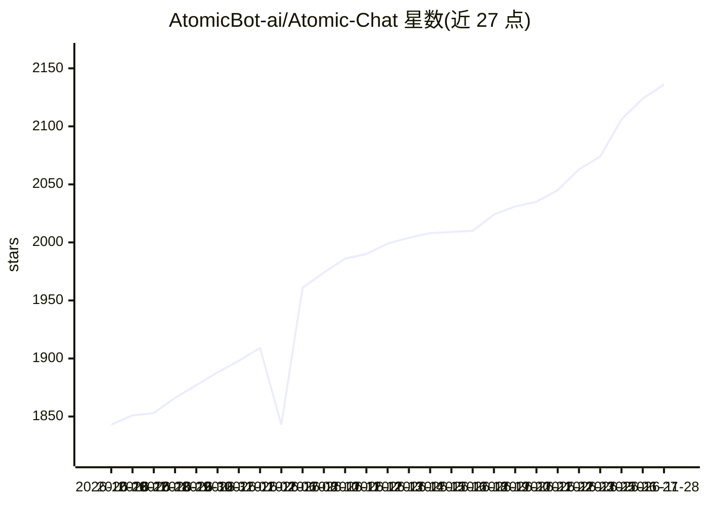

# AtomicBot-ai/Atomic-Chat

⭐ 2,136 · TypeScript · NOASSERTION · 推送 2026-11-27 · [GitHub](https://github.com/AtomicBot-ai/Atomic-Chat) · [官网](https://atomic.chat) · 组织维护

**本地运行开源大模型的桌面应用与推理引擎**

基于 Tauri 的本地 AI 应用与推理引擎：在 macOS/Windows/Linux/iOS/Android 上本地运行开放权重模型（GGUF、MLX 等），内置多个推理引擎（llama.cpp 系列、MLX-VLM、TensorRT-LLM、vLLM、SGLang 等）并在设置中按硬件安装；核心组件 atomic-chat-core 管理后端下载、模型与请求路由，并在 localhost:1337 提供 OpenAI 兼容 API，可接入各类 agent 与 IDE 插件；同时支持配置云服务商 API key。桌面端提供安装包，源码构建需 Node.js/Yarn/Rust。

## 筛选速览

| 维度 | 判定 | 备注 |
|---|---|---|
| AI 角色 | `ai-ecosystem` | LLM/agent 周边工具 |
| 许可风险 | `none` | NOASSERTION |
| 部署形态 | `desktop` | 安装包/桌面程序 |
| 模型依赖 | local-ok | 支持本地模型 |
| 硬件要求 | — | 无带数字的原话,不猜 |
| 安装摩擦 | `high` | 编译与系统依赖俱全 |
| 成熟度 | — | 结构信号不足 |

## 能力要点

- OpenAI 兼容本地服务器（localhost:1337/v1），任意 agent/CLI/IDE 插件可直接接入
- 多推理引擎管理：llama.cpp 系列、MLX-VLM、Foundry Local、GenieX、TensorRT-LLM、vLLM、SGLang 等
- 本地运行文本、视觉、图像、视频与音频模型（stable-diffusion.cpp、audio.cpp）
- 内置云服务商接入（OpenAI/Anthropic/Mistral/Groq 等），本地与云可混用

## 适用场景

- 在本地离线运行开放权重模型进行对话与生成
- 为本地 agent 与编码工具提供 OpenAI 兼容推理后端
- 按硬件（Apple Silicon/NPU/GPU）选择合适引擎运行模型
- 通过本地 API 做语音合成与图像/视频生成

## 场景标签

`推理引擎` `图像生成` `视频生成` `语音合成` · 领域:内容生成

## 证据(README 行号)

> L5: Local AI app and inference engine for agents. Run open-weight LLMs locally — private, on your machine.
> L100: Atomic Chat runs text, vision, image, video and audio models locally. Open **Settings → Providers** to install a p
> L140: The engines are driven by **atomic-chat-core** — the core of Atomic Chat, in its own repository. It doesn't do inf

## 星数曲线

2026-10-26 1,843 → 2026-11-28 2,136（+293）

---
*卡片 v1 · prompt 1.4 · 生成 2026-11-26 · 置信度 high · 依据 README sha `95c1ad94080e` · [字段定义](../../DATASET.md)*
